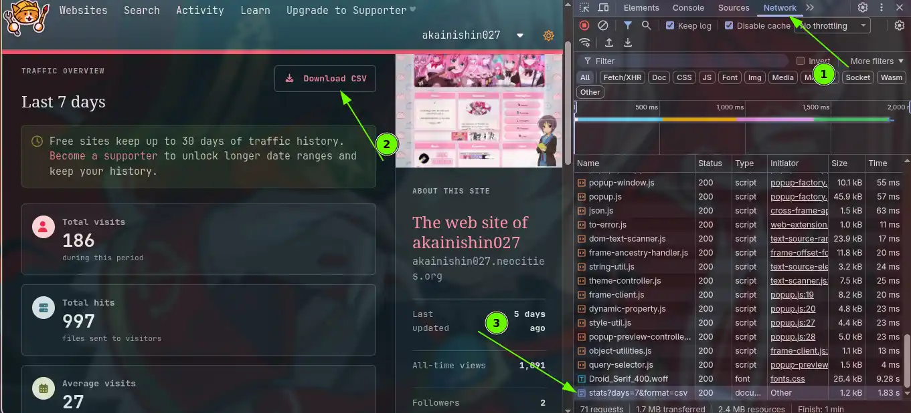
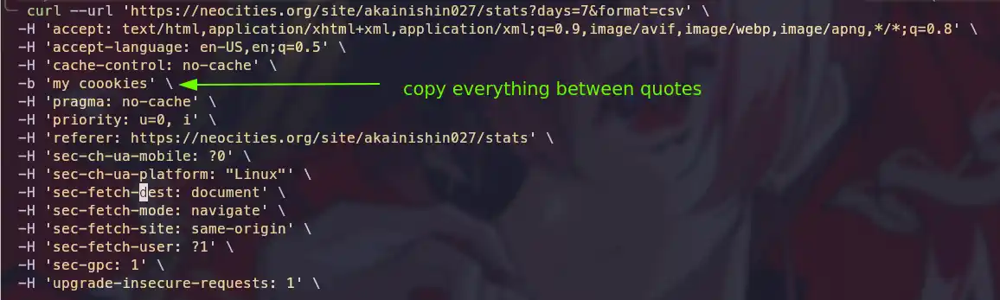

# Running unit test in C++ using CMake and Googletest
{:.no_toc}

- 
{:toc}

## Building a tiny TUI app to manage some stuff of my site

A few days ago I came up with the idea of doing a very simple [TUI](https://awesometui.com/) to 
manage some small stuff from my website like pushing updates, get site stats, 
historical views, add logs of changes among other stuff. 

<iframe width="560" height="315" src="https://www.youtube.com/embed/7xT97IxqVCw?si=AfcNtAdbECM7I5HD?autoplay=1" title="YouTube video player" frameborder="0" allow="accelerometer; autoplay; clipboard-write; encrypted-media; gyroscope; picture-in-picture; web-share" referrerpolicy="strict-origin-when-cross-origin" allowfullscreen></iframe>
<!-- <video autoplay loop playsinline style="width: 600px; height: auto"> -->
<!-- <source src="app.mp4" type="video/mp4"> -->
<!-- </video> -->

I decided to write it in C++ (since it is my favorite language) and use 
the Neocities API as well as using CMake as building system...the common thing. 
Then I was wondering how to run some test. I used to tryhard testing 
with prints and sometimes [CGDB](https://cgdb.github.io/) (let's all love GDB),
but this time I wanted to do some better. 
That is how I came with using [CTest](https://cmake.org/cmake/help/latest/manual/ctest.1.html)
and GoogleTest. 

## Project: minimal example setup

{:.code-box}
~~~cpp
├──  cacheFiles
│   ├──  COOKIE.txt
│   ├──  CREDENTIALS.txt
├──  CMakeLists.txt
├──  header
│   ├──  neocities.hpp
├── 󱧼 src
│   ├──  CMakeLists.txt
│   ├──  main.cpp
│   ├──  neocities.cpp
└── 󰙨 tests
    ├──  CMakeLists.txt
    ├──  neocities_test.cpp
~~~

The setup is quite simple. I decided to keep separated test cpp files, from source files, as show above
(it does not show all files, but basic snippet)
In the root directory's CMakeLists.txt I include the required packages for the app.
The most important line here is *enable_testing()* line. This MUST be written before
any **add_subdirectory()** or **include_directories()**. Among other stuff. 

{:.code-box}
~~~cpp
#CMakeLists.txt
project(NeocitiesTui LANGUAGES CXX)

set(CMAKE_CXX_STANDARD 23)
set(CMAKE_CXX_STANDARD_REQUIRED ON)
set(CMAKE_EXPORT_COMPILE_COMMANDS ON)
set(CMAKE_POLICY_VERSION_MINIMUM 4.0)
if(NOT CMAKE_BUILD_TYPE)
    set(CMAKE_BUILD_TYPE "Debug" CACHE STRING "Build type" FORCE)
endif()

# MODERN C++ TUI LIBRARY
include(FetchContent)
FetchContent_Declare(
    cpptui
    GIT_REPOSITORY https://github.com/jonoton/cpp-tui.git
    GIT_TAG        main
)
FetchContent_MakeAvailable(cpptui)

# more packages........

enable_testing() # IMPORTANT LINE BEFORE ADDING SUBDIRECTORIES

include_directories(header)
add_subdirectory(src)
add_subdirectory(tests)
~~~

Then in tests directory it is included the googletest package and link the required libraries. 
Each test is added by adding and executable, linking required packages to it and then the
**add_test()** function. This will mark the executable as test and build it to a separated directory.
Each executable in that directory here will have some unique interesting features that will allow adding functions
for testings. 

{:.code-box}
~~~cpp
#./tests/CMakeLists.txt
include(FetchContent)

FetchContent_Declare(
    googletest
    GIT_REPOSITORY https://github.com/google/googletest.git
    GIT_TAG        release-1.11.0
)
FetchContent_MakeAvailable(googletest)
add_library(GTest::GTest INTERFACE IMPORTED)
target_link_libraries(GTest::GTest INTERFACE gtest_main)

add_executable(json_parser_test json_parser_test.cpp)
add_executable(neocities_test neocities_test.cpp)
#...other libraries

target_link_libraries(json_parser_test
    PRIVATE
    GTest::GTest
    json_parser
    )
target_link_libraries(neocities_test
    PRIVATE
    GTest::GTest
    neocities
    )

add_test(json_parser_gtest json_parser_test)
add_test(neocities_gtest, neocities_test)
~~~

## Defining an example test for neocities api library

Let's define something in our neocities library (neocities.cpp a simple library in my project that acts as a wrapper 
to neocties API using curl and some small extra utilities), and create some unit test in neocities_test.cpp file.
In neocities there is a section in traffic stats that contains a CSV file that allows the site to show a graph
of historic views and hits over time. Sadly the neocities API does not offers a single way to download that
file, you can either construct it yourself running 'Site Info' request every certain time and fill a local CSV file
or try a workaround using CURL to download the file. I tried this second approach.
The method is quite dirty. I am very bad in all webdev related and low-level libraries. 
But I manage to get it working. The idea is login in my browser to neocities page, download manually the file once,
the open the developer console in the browser and in Network tab look for the downloaded file, press right click
and copy as CurL. Then I pasted the content somewhere and copy everything in the -b flag of the result
to a file called ./build/tests/cachedFiles/COOKIE.txt. The reason is that this file is in the account. 
You need login session to be able to download the file, and it is not exposed to the API,
in consequence it is necessary to have some logging information to be able to access the account. 
I was uncapable to solve this with curl. I did not know how, so I implemented this workaround.

Then I wrote this method. This will download the filed given some credentials and the session cookies
we got previously as a string. The method return either a bool (does not matter is just to fill required
parameters of std::expected) on success or a string indicating the error on failure.
I wrote it like this to get some logging information in the app when something fails.

{:.code-box}
~~~cpp
./src/neocities.cpp
static size_t downloadCallback(void *contents, size_t size, size_t nmemb, std::ofstream* userp) {
	userp->write(static_cast<char*>(contents), size * nmemb);
	return size * nmemb;
}

std::expected<bool, std::string> 
Neocities::downloadStats(const Neocities::Credentials &credentials, const std::string& sessionCookie) {
	std::string url = std::format(
        "https://neocities.org/site/{}/stats?days=7&format=csv",
        credentials.name);

	std::ofstream file("cacheFiles/site_history_stats.csv", std::ios::binary);
	if (!file.is_open()) {
		return std::unexpected("Failed to open file 'cacheFiles/site_history_stats.cv'");
	}

	CURL* curl_handle;
	CURLcode result;

	result = curl_global_init(CURL_GLOBAL_DEFAULT);
	curl_handle = curl_easy_init();
	if (result == CURLE_OK && curl_handle) {
		curl_easy_setopt(curl_handle, CURLOPT_URL, url.c_str());
        // enables in-memory cookie engine
		curl_easy_setopt(curl_handle, CURLOPT_COOKIE, sessionCookie.c_str());  
		curl_easy_setopt(curl_handle, CURLOPT_FOLLOWLOCATION, 1L);
		curl_easy_setopt(curl_handle, CURLOPT_WRITEFUNCTION, downloadCallback);
		curl_easy_setopt(curl_handle, CURLOPT_WRITEDATA, &file);

		result = curl_easy_perform(curl_handle);
		
		long code = 0;
		char* ctype = nullptr;
		curl_easy_getinfo(curl_handle, CURLINFO_RESPONSE_CODE, &code);
		curl_easy_getinfo(curl_handle, CURLINFO_CONTENT_TYPE, &ctype);

		bool isCsv = ctype && std::string(ctype).find("csv") != std::string::npos;

		file.close();
		curl_easy_cleanup(curl_handle);

		if (result != CURLE_OK || code != 200 || !isCsv) {
            // don't leave a fake CSV behind
			std::remove("cacheFiles/site_history_stats.csv");
			std::string response = std::format("curl_easy_perform() failed: {}",
                curl_easy_strerror(result));
			return std::unexpected(response);
		}
	} else {
		return std::unexpected("Failed to init libcurl");
	}
	return true; // just fine
}
~~~

Then I wrote the test.
It first checks if the COOKIE.txt file exist.
If not, it forces the test to finish as failed.
Then the method **downloadStats()** is called.
If the result has a value and the file site_history_stats.csv exist then 
the test should pass. 

It works noticing how test is defined. The test is wrotten in a TEST(suitname, testname)
macro offered by the Google test library included in "gtest/gtest.h". 
The first parameter, often called (test case name) is used to group 
logically related test together, while the testname is a unique identifier for
and individual test in the suit test. The two parameters are combined to form 
a full name that may be used for filtering and report result. 

{:.code-box}
~~~cpp
#include <neocities.hpp>
#include "gtest/gtest.h"
#include <filesystem>
#include <string>
#include <fstream>
#include <utility>

TEST(NeocitiesApi, DownloadHistoryStats) {
	std::ifstream file;
	
	auto credentialsRead = Neocities::getCrendentials();
	ASSERT_EQ(credentialsRead.has_value(), true);
	Neocities::Credentials credentials = credentialsRead.value();

	std::string sessionCookie;
	file.open("cacheFiles/COOKIE.txt");
	ASSERT_EQ(file.is_open(), true);
	std::getline(file, sessionCookie);
	file.close();

	auto result = Neocities::downloadStats(credentials, sessionCookie);

	fs::path siteStatsFile = "cacheFiles/site_history_stats.csv";
	bool isRegularFile = std::filesystem::is_regular_file(siteStatsFile);
	bool succesDownload = ((result.has_value()) && isRegularFile);

	EXPECT_EQ(succesDownload, true);
}

int main(int argc, char** argv) {
	testing::InitGoogleTest(&argc, argv);
	return RUN_ALL_TESTS();
}

~~~

## Running test. Different ways to do it

The building is done as always cmake -S . -B build and cmake --build build. 
But now in build directory we are going to have a directory called tests with our test executables.
There are different ways to run the test. One is first move to build directory (cd build)
and run ctest -j 4 --output-on-failure. This will run all executables, all suits and all test. 
The -j 4 indicates parallel processing so that it runs faster using more cores of your machine and
--output-on-failure show prints or extra information if test fails or crashes.
Another way is just run a single executable ./test/executable_name_test. 
This will run all tests in that executable. 
Also, it is possible to filter test using --gtest_filter keyword passing either suitnames
or pair suitname.testname. Since I actually wrote many more test lest keep up with this last,
and run the test. I passed an extra flag (-V) this is verbose. It shows more detailed 
response of each test.

{:.code-box}
~~~zsh
./build/tests/neocities_test --gtest_filter=NeocitiesApi.DownloadHistoryStats -V

Note: Google Test filter = NeocitiesApi.DownloadHistoryStats
[==========] Running 1 test from 1 test suite.
[----------] Global test environment set-up.
[----------] 1 test from NeocitiesApi
[ RUN      ] NeocitiesApi.DownloadHistoryStats
[       OK ] NeocitiesApi.DownloadHistoryStats (1310 ms)
[----------] 1 test from NeocitiesApi (1310 ms total)

[----------] Global test environment tear-down
[==========] 1 test from 1 test suite ran. (1310 ms total)
[  PASSED  ] 1 test.

./build/tests/json_parser_test
[==========] Running 2 tests from 1 test suite.
[----------] Global test environment set-up.
[----------] 2 tests from JsonParser
[ RUN      ] JsonParser.ReadingFile
[       OK ] JsonParser.ReadingFile (0 ms)
[ RUN      ] JsonParser.AddingLog
[       OK ] JsonParser.AddingLog (0 ms)
[----------] 2 tests from JsonParser (0 ms total)

[----------] Global test environment tear-down
[==========] 2 tests from 1 test suite ran. (0 ms total)
[  PASSED  ] 2 tests.
~~~

Will this make the code infallible?...of course it will not, but help to test small pieces of code,
do tiny changes and test a few operations without running all the code. The test 
will be as robust as oneself writes rigorous test. Indeed, I am not that good, 
and even when this is very tiny project I ended up discovering new bugs as I was writing this. 
There is even one I do not know yet how to solve...
It is not critical thought.
