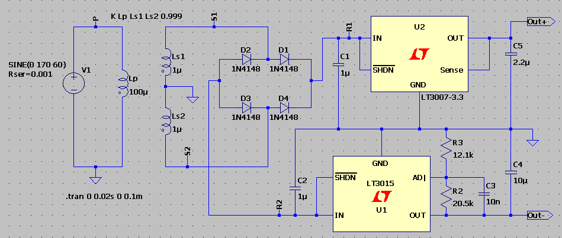
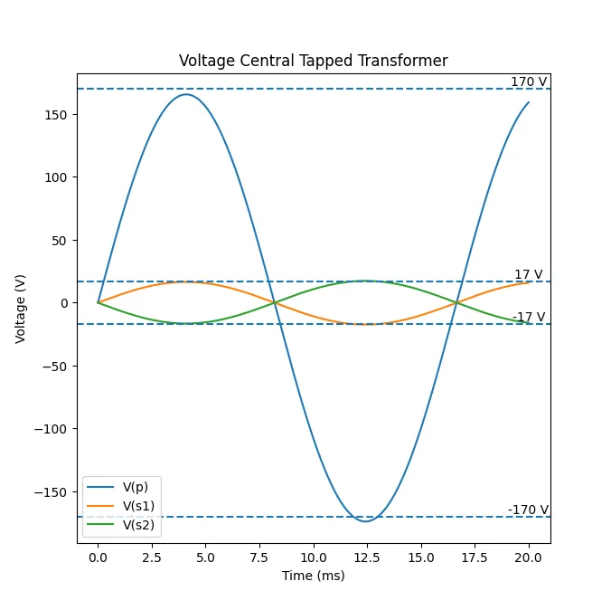
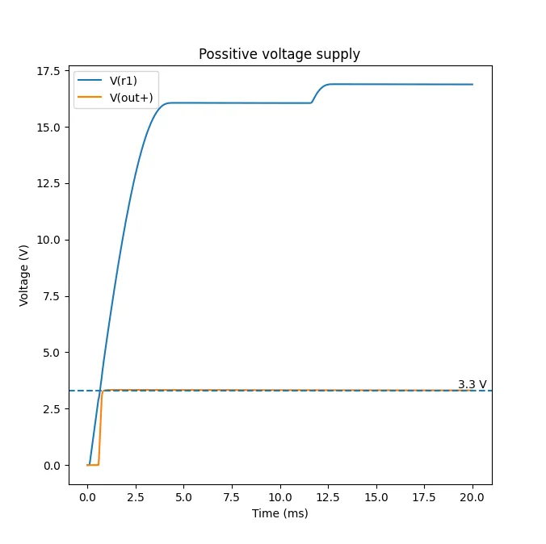
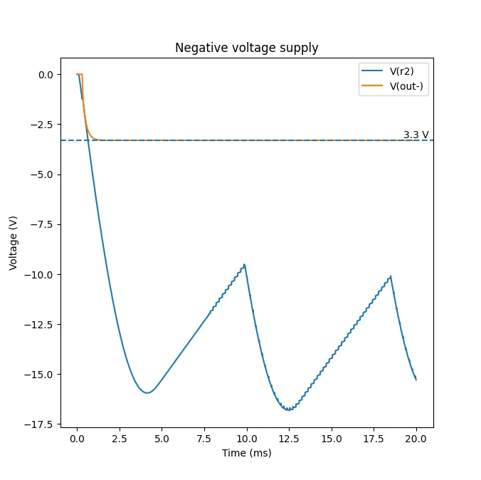
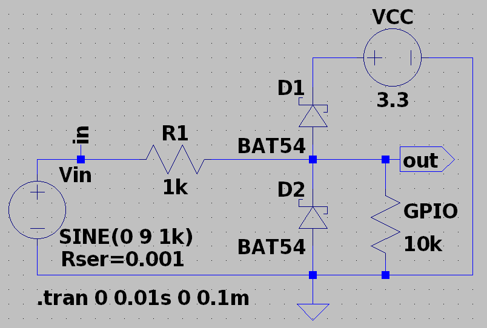
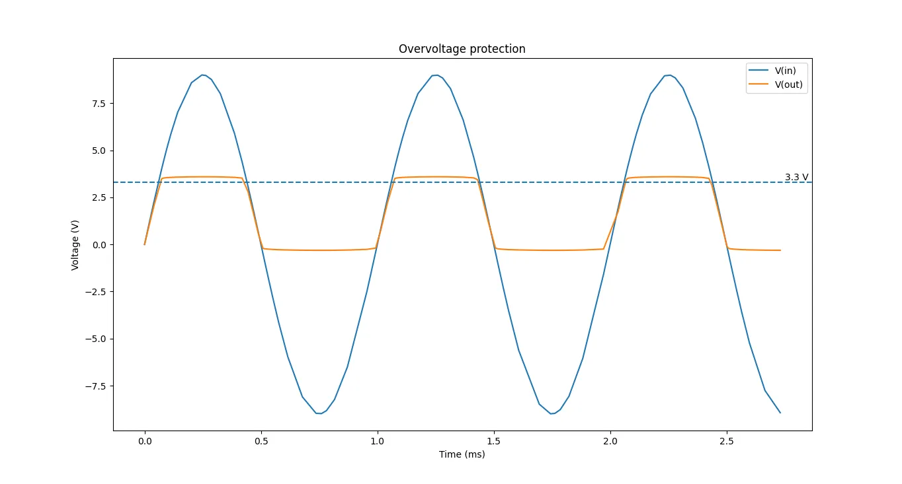
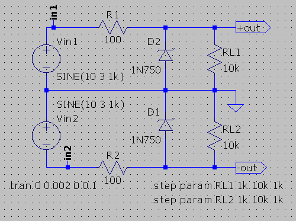
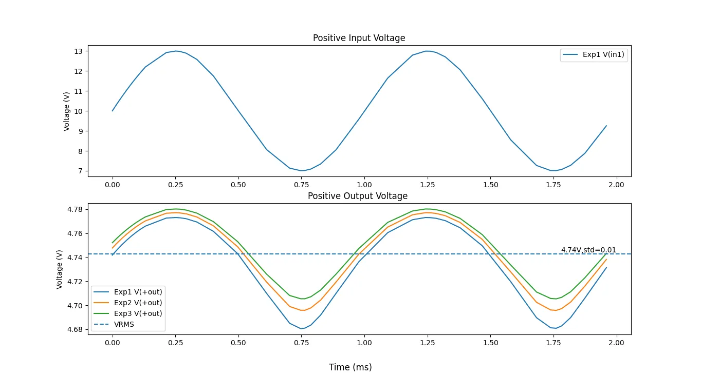
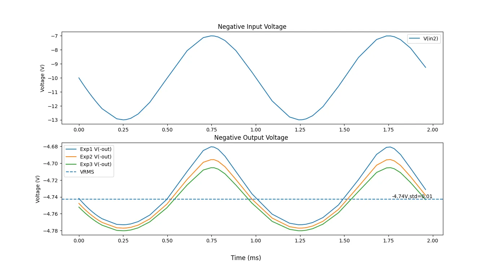

# An introduction to semiconductors devices: Diode. And use examples with circuit design.

{:.no_toc}

- 
{:toc}

## Diode conceptual theory.

{: style="background: #ffffff; display:block; margin-right: 1em; margin-bottom: 1em; float: left"}

A diode is formed by doping Silicon pieces by inserting impurities
that form a N material in piece and a P material on the other. 
Then joining both pieces together.

The free electrons in N region move randomly in all directions. When the PN junction
is formed the free electrons move near the junction with P material and join with its holes
near to junction, so that it loses electrons and forms a positive charged layer near the junction
(a positive ion). On the other hand the P region loses holes forming a negative charged layer 
(negative ion). These two layers form the depletion region when the difution reaches a balance.
The depletion region as a barrier that prevent electrons to continue passing to the P region.
The force produced between the negative and positive charges produce a electric field. 
The electric must be consume so that electrons may continue its path through the Silicon;
in other words, and external energy must be applied to move electron through the depletion region.
Of course the external energy is a Voltage, and must be applied in an adequate polarity to the material,
and it must be equal or higher than the depletion region energy gap.

A fordward-bias allows a flow of current through the PN junction. 
This happens by applying a direct current voltage VCC,
the positive VCC+ terminal is applied to P material and negative VCC- is applied to N material.
Since equal charge repel each other the negative terminal pushes the electrons
in the N material to the PN junction. It also pushes electrons from the external conector or wire
to N manterial. The resistor limits the current to a value that does not harm the diode. 
It also allow to attach a multimeter to measure the V-I characteristic curve that shall discuse later.

If the voltage source is high enough free electrons may beat the potential barrier of depletion region 
and continue the displacement through the P material. When this happens, electrons loses energy and combine
with holes in Valence band. 

But since different sign charges attract to each other, the positive terminal of the voltage source
attracts the electrons in the Valence band to the connector or wire connected to P material (to the left). 
The holes in P material act a path for the electrons. 
Then is like holes "moves" to the depletion region (to the right). 

As electrons move from the P region to the voltage source they free holes in P region. 
At the same time these electrons can freely move through the metalic connector in the voltage source. 
This metalic conductor has a very low energy gap traslaping with the valence band so that 
electrons can flow easily in this conductor rather than in diode. For this reason
there are a constant flow of electrons through this conductor from the P region to N region;
allowing a repetitive cycle, or in other words a constant flow of current (IF).

On the other hand, reverse bias is the condition that prevent current to flow through the diode.
It happens when the voltage source is applied in contrary way than forward bias;
in other words, when VCC- is connected to P region and VCC+ is connected to N region.
Since opposite charges attracts to each other the positive terminal of voltage source VCC+ attracts 
electrons to its connector farther from the PN junction. 
Something similar happens with P side, where VCC- "attracts" holes to its connection
farther from the PN junction. Both phenomenon cause an increase of the depletion region wide.
This also increase the potential barrier. It will remains a very small current caused
by temperature.

Usually inverse current is so slow that it can be ignored. However, 
as the inverse voltage increase it gives energy to electrons causing and
increase of speed in the flow. When they have suffient speed the impacts
again atoms in P region causes that a release from valence band and send them 
to the conduction band. These new electron repeat the phenomenon in a chain effect. 
If an electron release two electron from their orbit the numbers increase, 
until the energy is enough to pass to the N region. 
The increment of this chain effect can increase drastically causing a drastic
increment in current flowing that may burns the diode.

Since both sides repel charges of equal sign. VCC+ "pushes" holes to the depletion region,
while VCC- "pushes" electrons. It causes a momentary increment of 
holes and electrons near the depletion region which causes a decrement in potential barrier
in the depletion region. As the differential of potential in source VCC increases
over the minimal potential barrier, the current increases.
With each increment of VCC the current IF increases faster, since the relationship
is non-linear, but exponential.
This is caused because in a decrement in the intrinsic resistance of the semiconductor.
The measurement of the current. The relationship between the voltage measure between diode 
terminals and the current flowing through it is called the characteristic curve of the diode,
because it describe its behavior.

As its possible to see in the first graph below the current IF (fordward-bias current)
is \~0 A between 0 V - in VF (fordward-bias voltage). Then it increases exponentially to "infinity" 
(this actually is not possible, the diode will burns), while VF remains almost constant. 
This means VF is the potential requiere to beat the potential barrier of the depletion region. 
Not all diodes have the same
potential barrier, it depends of intrisic materials used for N and P material, the quality of doping, 
and temperature. For many PN silicon diode, a fordward bias voltage is around $$0.6V-0.7V$$
at it is used a useful approximation.

As described above inverse current may also flow when sufficient voltage is applied in 
reversed-bias. And the V-I characteristic curve is very similar but in the third region
of cartesian axis. Also, since temperature may affect potential barrier 
the voltage where current increase drastically may move from with a certain margin
of error.

Since VF is relative constant, when doing a circuit analysis diode
may be modeled as ideal. The model will depend of the use case and importance of VF
in the circuit. For fordward bias it may be modeled either as short circuit VF = 0 V or 
VF constant, like VF = 0.7 V. For reverse bias it may be modeled as 
open circuit.

In addition, it is convenient to know how it looks and names that are given to connections.
In datasheets and reference documents the P region is called anode
and the N region is called cathode. 
In through-hole diode, to visualize what region is in the physical device, most of the time the N region
is denoted with white or gray band, while the body is ussually black.
In schematic, most of the body is triangular free and the N region is noted with a parallel line,
nad the P region indicates is the base of the triangle.
The reason to indicate the N region with a bar is to show the direction where the current "flows",
or in other words the direction required to fordward bias it, since fordward bias 
is the typical region of operation of the classic diode (there are other types of diodes
that operates in reverse bias).

### A real case example: Dual supply voltage source with full wave rectifier.

A dual supply voltage source is capable to source source a positive 
and a negative voltage source using a single circuit. 
It uses as an input an alternating (CA) voltage input
and return two direct voltage source (CC) of opposite sign (VCC = +Vout and VDD = -Vout). 

For circuits simulation I used LTSpice. Since it does not have a spice model
for transformers I had to simulate it. The way to do it is by adding 
three inductors to simulate the coils. The primary $$L_{p}$$ is connected to residential voltage 
meanwhile secondary coils $$L{s1}$$ and $$L{s2}$$ are in series with 
a Ground between them. They are separated by a gap. 
Since LTSpice does not understand about this physical gap, it just "see"
to separated circuits, there is the need to add a Spice operation
$$K\ L_{p}\ L_{Ls1}\ L_{s2}\ 0.999$$.
Read this <a href="https://web.cecs.pdx.edu/~tymerski/ece222/How%20to%20create%20a%20transformer%20using%20LTSpice.pdf">document</a>
 for reference.
In Costa Rica, residential
voltage source is $$120V_{RMS}$$ ($$170V_{peak}$$) and $$60Hz$$. 
So I configured the input in primary coil with those parameters.
I also added a parasitic resistance of $$0.001\ \Omega$$ because
LTSpice complains about infinity matrix when source and inductor are in parallel.
The relationship between output voltage in secondary coils is given by next formula.
Which mean that I should expect around $$17V_{peak}$$ in each secondary.
You can see that in the image at the side. It is the result
of simulation in LTspice. I decide to process the results
with Python for a better visualization. I also added some dashed horizontal 
lines as reference of values I was expecting. 
You can see that the result is slightly slower than the expected.
That is the effect of parasitic impedance; but the results are very good.

$$ \frac{V_{p}}{V_{s}} = \frac{N_{p}}{N_{s}} = \sqrt{\frac{L_{p}}{L_{s}}} = \sqrt{\frac{100}{1}}=10 $$

For this case I decided to use the <a href="https://www.onsemi.com/download/data-sheet/pdf/1n914-d.pdf">1N4148</a>
as full wave rectifier, since it is a very common device.
It supports the current flowing in this use example. But in general the selection
must be more careful, since 1N4148 is for low current applications. In this example is fine.
The way this bridge works is like this: In half positive cycle of input voltage coming from
residential source the first secondary recoil has a half positive cycle 10 times smaller
than the residential source. Meanwhile the second secondary coil has a the half negative cycle. 
This mean that secondary has a $$180^{\circ}$$ of phase. 

The terminal with higher potential in first secondary will be $$V_{p}$$ and this shall be higher than $$V_{r1}$$ since 
capacitor are discharge and there is no other voltage source, so D1 is fordward-bias. 
The current will flow for the circuit passing through voltage regulator and will return to the bridge
through ground. Then $$V_{s2}$$ is negative and slower than the voltage in anode of D3. 
Then D3 is fordward bias too In this cycle second secondary is negative, D4 will not allow current flow as well as D2.
Current will flow also through negative regulator to D2 and D2 to 
second secondary, completing the path to the common ground and the circuit. 
When this happens $$V_{r1}$$ will have a high potential above of $$0V$$ and $$V_{r2}$$ and low below of $$0V$$.
The same analysis is done in next half cycle. But this time D2 and D4 are fordward bias,
meanwhile D1 and D3 do not allow flow of current. 
Again $$V_{r1}$$ will have a potential above $$0V$$ and $$V_{r2}$$ will have potential below $$0V$$.
So, in both half cycle $$V_{r1}$$ is positive and $$V_{r2}$$ is negative. 

On the other hand, typically
I prefer to use simple three terminal fixed voltage regulator as output. 
But first $$\pm3.3V$$ regulators are uncommon. And
Negative regulators are generally difficult to find. 
It is more common to adjustable regulators, and sometime fixed positive like $$5V$$, $$12V$$, $$15V$$.
Also LTSpice does not include LM regulator, which are my preferred for example, I would
have used <a href="https://www.ti.com/lit/ds/symlink/lm337.pdf?ts=1789508157076&ref_url=https%253A%252F%252Fwww.ti.com%252Fproduct%252FLM337">LM337</a> for -3.3 V and <a href="https://www.ti.com/lit/ds/symlink/lm317.pdf">LM317</a> for 3.3 V.
So instead I used <a href="https://www.analog.com/media/en/technical-documentation/data-sheets/3007fa.pdf">LT3007</a>
for the positive output $$3.3V$$. This IC is a fixed $$3.3V$$ voltage regulator. So there is nothing to adjust.
The only thing to do is to add the recommeded capacitors for ripple in input and output stabilization.
The for the negative output $$-3.3V$$ I used the 
<a href="https://www.analog.com/media/en/technical-documentation/data-sheets/3015fb.pdf">LT3015</a>.
This is an adjustable voltage regulator. It is adjusted with next equation; where
generally $$I_{ADJ}$$ is very small and ignored. 
So with $$R_{3}=12.1k\Omega$$ and $$R_{2}=20.5k\Omega$$ it it possible to do it.
It may be convinent to change some capacitor to reduce ripple. 
But it is fine if I keep it like it is in the datasheet for this example.

$$ V_{out} = -1.22\left(1 + \frac{R_{2}}{R_{3}}\right) + I_{ADJ}R_{2} = -1.22\left(1 + \frac{R_{2}}{R_{3}}\right) $$

The next two images show the results. The first one shows the input voltage at the positive voltage regulator
and the positive output of the circuit. As shown, it takes an small time for the signal increase
until $$ 3.3V$$ in the output. This is an effect of the timing restricction for capacitors to fully charge.
Also, in the input to the voltage regulator ($$V_{r1}$$), the increment takes longer, to about $$2.5ms$$
until a stable point. After that it keeps increasing and decreasing very slowly, like each $$8ms$$.
This effect is caused because capacitor tries to discharge in each half cycle of input altenating voltage from secondary coil;
and is called ripple. The [ripple](https://en.wikipedia.org/wiki/Ripple_(electrical))
voltage is the peak to peak voltage in the oscillation.
Similar effect happens in the second image. In this case the voltage ripple in the input of
the negative voltage regulator is very large. However, since the output remains stable near $$-3.3V$$,
it does not affect to the purpose of the circuit.

### A real case example: Overvoltage protection for an STM32F103C8T6

An [STM32F103C8T6](https://microcontrollerslab.com/stm32f103c8t6-blue-pill-pinout-peripherals-programming-features/)
is an MCU widly use for hobbiest and even for professional electronic projects
that requieres some kind of small computing. This MCU has many general purpose input-output (GPIO) pins
that serves for interacting with the world, by either acception user input, reading sensor, 
or sending data. But most of GPIO are only capable to source or receive $$3.3 V$$; 
so that for interaction with the world sometimes is necessary to add some protection for 
voltage over upper bound limit. This may be achieve by a kind of circuit called clamping,
and it is usually built using diodes.

The first figure shows an example of clamping circuit, and the next one shows the result from simulation
in LTSpice. For this example I decided to use a Schottky diode. This is an special kind of diode
that instead of using P material uses a metal. This produce a smaller depletion region,
so that it is easy to fordward bias the devices, in consecuence the clamping 
produces earlier and also offers fast switching behavior. I selected the BAT54 Schottky diode
as an example. A thoghutful analysis will verify current limit and power consumption.
It will be controlled by the $$ R_{1} $$ resistor. But for this example. I will just use $$ 1k\Omega $$.
STM32F103C8T6 configured as input offers high input impedance; over $$ 10k\Omega $$.
So I used that resistance as load. For input voltage I used alternating voltage source
$$ 9\sin{\left(2\pi 1kHz\right)} V$$. And the maximum voltage is going to be $$ 3.3V $$.

The analysis of this circuit is very simple. Let suppose the input voltage starts at $$0V$$.
As the diode D1 is connected to anode at $$3.3V$$
it acts as open circuit, since it is not in fordward-bias yet.
The same happens with D2, becuase anode is connected to Ground $$0V$$. 
Then as the input voltage starts increasing in the positive half cycle, 
when it becomes greater than $$3.3 V + VF_{D1}$$; or in other words
the maximum voltage plus the differential of potential for fordward bias the diode. 
Then D1 starts flowing current and acts as a "short-circuit". 
Then it offers direct a path from the output node to  to $$3.3V$$ and then 
the output voltage do not increase greater than $$3.3V + VF_{D1}$$; independly of 
the voltage in $$V_{in}$$. In all moment D2 did not enter in fordward bias; 
instead it acted as "open-circuit".
In the next half cycle; the negative half, D1 cathode is going to be always lower than anode
$$3.3V$$, so it acts as open-circuit. Meanwhile, when $$V_{in}$$ decreases
from $$0V$$ to $$-VF$$, D2 will act as open circuit, because the differential of potential
will be lower than fordward-bias, but as $$V_{in}$$ decrease lower than $$-VF$$, then
the differential of potential will become greater than $$VF$$ and fordward bias the diode.
But when it happens, it will acts as a shot-circuit offering a path between ground and output node.
Then, the output node will become $$-VF$$ and will keeps constant at tha value.
In consecuence, in the positive half cycle the output node will not have a voltage
greater than approximatelly $$3.3 V$$ and in the half negative cycle it will not be
lower than approximatelly $$0V$$.

## Zener Diode

One of the main applications of Zener diode is to produce constant voltage source
since it can operates to relative constant CD voltage according to certain circumstances.
The Zener diode is a silicon PN junction designed to operate in reverse bias. 
The breakdown voltage is controlled during doping. While
tipical diodes have high breakdown voltage $$20V$$, $$-50V$$, etc. 
Zener diodes have a low breakdown Zener; sometimes less than $$5V$$.

It is heavily affected by temperature according to a temperature coefficient.
It is expressed as $$\Delta V_{Z}=V_{Z}\times T_{C}\times \Delta T$$. 
For example, with a temperature coefficient of $$0.01\%/^{\circ}C$$
a $$12V$$ zener increments $$1.2mV$$ when temperature increases 1 Celcius.

### A real case example: Voltage regulator with variable load.

For this design I decided to use the Zener diode 
<a href="https://circuits-diy.com/wp-content/uploads/2021/05/1N750-1N759.pdf">1N750</a>
This diode has maximum regulator current ($$I_{ZM}=75mA$$), test current $$I_{ZT}=20mA$$,
, nominal zener voltage $$V_{Z}=4.7V$$ and maximun reverse leakage current $$2\mu A$$. 
For testing I will use a variable load and a variable input voltage.
The variable load changes from $$500\Omega$$ to $$10k\Omega$$.
The input voltage is $$vin=3\sin\left(2\pi\ 1kHz\right)+10\ V$$

The circuit is actually composed of two circuits. 
The circuit at top produces a positive output, while the circuit at bottom produces a negative output.
Lets analyze the top circuit, the bottom circuit will have the same result but inverted.
It is necessary two know the load this circuit can manage with relative constant output.
First, lets suppose that there is no load $$R_{\infty}$$ so that $$I_{L}=0A$$,
the current through zener diode will be maximum and equal to the current in R ($$I_{T}$$). 
I will calculate with mimimum input voltage $$7V$$ 
("worst input case that will not turn on the diode").
Since $$I_{Z(max)} < I_{ZM}$$ then device can take all current.

$$ I_{Z(max)} = \frac{V_{IN}-V_{Z}}{R}=\frac{7-4.7V}{100}=23mA$$

On the other hand, it is necessary to know miminum load. 
As the load decreases from "open-circuit" to $$0\Omega$$ 
some will flow through load increasing, until a miminum load
that will allow sufficient current to flow through diode. 
In this case a minimun current $$I_{ZK}$$ will be flowing through the diode
and in the load the current will be the next relationship.
In my case the datasheet does not include $$I_{ZK}$$.
Ideally, we should measure it in a laboratory,
but I will instead suppose a value for simplicty.
For this theoretical example, I will assume $$I_{ZK}=3\,mA$$.
This value is not taken from the datasheet, 
so the resulting minimun-load calculation should be considered an illustrative estimate rather than a validated design limit.

$$ I_{L(max)} = I_{T}-I_{ZK} = (23-3)mA=20mA$$

Then the mimium load is

$$ R_{L(min)} = \frac{V_{Z}}{I_{L(max)}} = \frac{4.7V}{20mA} = 235\Omega$$

So this circuit in theory can handle relative constant voltage output 
of $$4.7V$$ as long as the load is between $$250\Omega$$ 
(rounding to a upper value that you can buy in an shop) and $$\infty\Omega$$

The image above are results of both circuits (postive and negative outputs). 
In the positive output circuit the input is sinusoidal between $$13V$$ and $$7V$$.
I plotted result for load of $$500\Omega$$, $$1k\Omega$$ and $$5k\Omega$$.
But wait...the output are sinusoidal too?!. Yes, they are.
But if you take a look the $$V_{peak-peak}$$ or error are around just $$80mV$$.
Most of the time those variance can be ignored and instead take care of 
effective voltage $$V_{RMS}$$; in all cases this voltage is near $$4.7V$$
There is a small variance, outputs does not follow exactly the same curve. 
However, they are still very similar. To know how similar,
I calculated the average $$V_{RMS}$$ and standard deviation (std or $$\sigma$$).
I got $$V_{RMS(avg)}=4.74V$$ and $$\sigma=0.01$$; just $$1\%$$ of deviation.
Finally, of course, if the small variation in output is critical in you application,
you could also add some capacitor parallel to the load to reduce variance.

<!-- ## BJT conceptual transistor -->
<!---->
<!-- ## A real case example: PWM signal generation. -->
<!---->
<!-- ## A real case example: Audio amplifier. -->

## Appendix

How calculate $$V_{RMS}$$ in time continuos and discrete form. 
In discrete form use N samplings in a period T.

$$ V_{RMS} = \sqrt{\frac{1}{T}\int_{0}^{T}V(t)^2dt} \quad\quad V_{RMS}=\sqrt{\frac{1}{N}\sum_{i=1}^{N}V_{i}^2}$$

Formulas with relationship between $$ V_{RMS} $$ and $$ V_{peak} $$

$$ V_{rms}=\frac{1}{\sqrt{2}}V_{p} = 0.707V_{p}\quad \quad
V_{rms}=\frac{1}{2\sqrt{2}}V_{pp} = 0.353V_{pp}\quad \quad
V_{rms}=\frac{\pi}{2\sqrt{2}}V_{avg} = 1.111V_{avg}$$

## References.
- Electronic Devices from Thomas. L Floyd.
- <a href="https://web.cecs.pdx.edu/~tymerski/ece222/How%20to%20create%20a%20transformer%20using%20LTSpice.pdf">How to create a transformer using LTSpice</a>
- [Clamping diode guide](https://www.ersaelectronics.com/blog/clamping-diode-guide)
