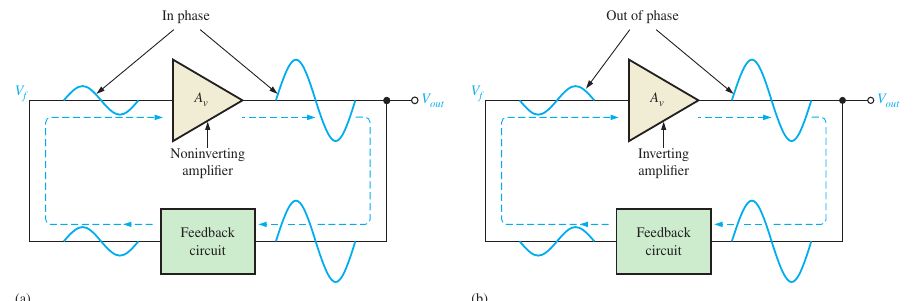
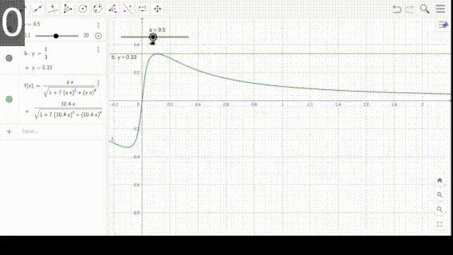
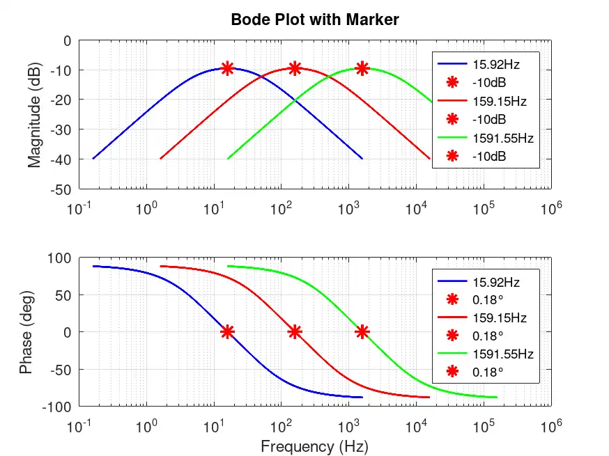
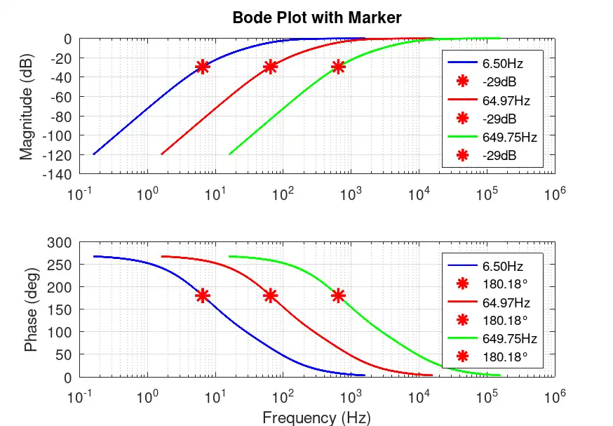
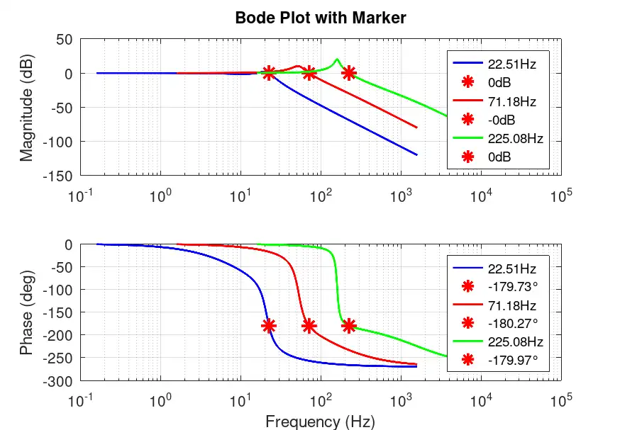
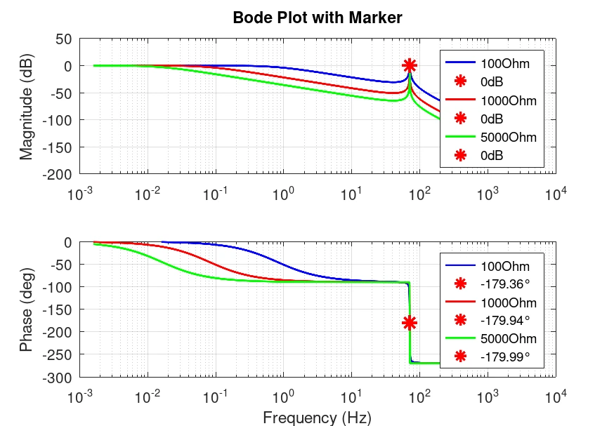
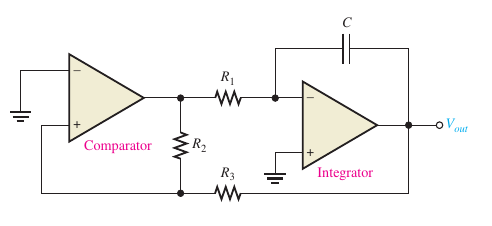
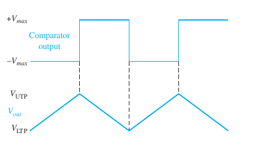
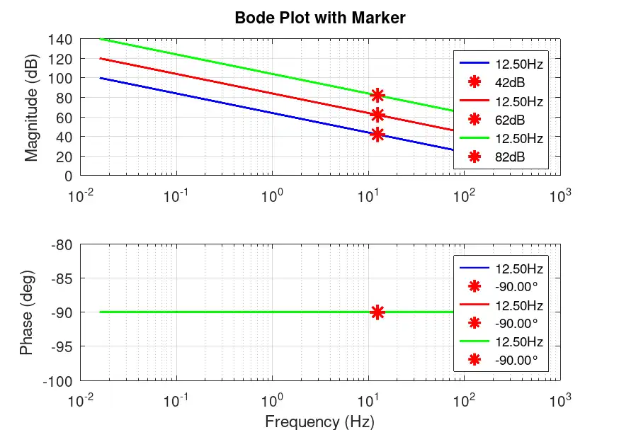

# Making sense of electronic oscillators.

{:.no_toc}

- 
{:toc}

## Introduction. 

An oscillator is a circuit that produces a periodic waveform on its output using only the 
voltage DC supply as input. They are classified in two categories.

Oscillators have been always one of the hardest topic in electronics to me.
There are various reasons. In University we did not have too much time
to messing around with designs. So must of the time I just picked up
a design I found in a book and changed some parameters using formulas
from the books. In addition, the books for learning does not includes 
too much in depth analysis of oscillator. There is usually just
a brief introduction of what is required in a circuit to oscillate in a high level
analysis. Then some basic circuit example and how they are suppose to 
achieve the conditions, but without a proper mathematical analysis and 
finally some common topologies and the formulas required for 
the circuit to work; again without formula derivation.
Now that I have some time I wanted to get a prober understanding of oscillator;
or at least going further in the common analysis I usually find in the internet.

## Feedback oscillators

This kind of oscillators returns a fraction of the output signal to input signal.
The total phase shift is $$0^{\circ}$$, resulting in a reinforcement of the output (it becomes larger).
For sine waveforms the closed loop gain must be 1, this prevents distortion.
Loop gain greater than 1 results in a distorted and clipped output. 
If the main amplifier introduces a shift the feedback circuit must provided sufficient shift
to compensate. This is achieve by a positive feedback mechanism as shown in figure.
The criterion to oscillation is resumed as follow, and it is called 
[Barkhausen stability criterion](https://eeebooks4u.wordpress.com/2021/05/26/barkhausen-stability-criterion/)

- The net phase shift around the feedback loop must be effectively $$0^{\circ}$$. 
For non inverting amplifier the phase shift is $$0^{\circ}$$ so the feedback stage
must return a net phase shift of $$0^{\circ}$$. 
Inverting amplifiers produces an output with $$180^{\circ}$$ of phase shift. 
So the feedback stage must return another $$180^{\circ}$$ for a net phase shift 
$$360^{\circ}\rightarrow 0^{\circ}$$

- The voltage gain $$A_{cl}$$ around the closed loop must be equal or greater than 1. 
If imagine that a initial signal $$V_{i}$$ is applied to amplifier, 
then output is $$V_{o}=A_{v}V_{i}$$. But since the output is the attenuated
as feedback like $$V_{f}=BV_{o}$$, and since $$V_{o}$$ appears in both equations;
$$V_{f}=A_{v}BV_{i}$$. If the gain is greater than 1 the output grows without control,
if less than 1 then output decreases until 0. If the gain is 1 it enters in a sustained oscillation.

But where does the initial voltage comes from?  Initially a small positive feedback voltage
develops from thermally produced white noise in the components of the circuit.
The feedback allow only a voltage with selected frequency of oscillation to appear 
in the input of the amplifier. This input is amplified and returned again to the 
loop.

### Wien-Bridge oscillator.

The [Wien-Bridge](https://en.wikipedia.org/wiki/Wien_bridge_oscillator)
oscillator works by adding a series of RC circuits in a specific topology
in the feedback loop. Lets analyze it. First of all we need to know what the transfer function is.
Of course to simplify everything the circuit is analyzed in frequency domain,
and the [Laplace transform](https://en.wikipedia.org/wiki/Laplace_transform) is applied to the components.

The RC in parallel at the output has the next equivalent impedance.

$$ Z_{T1} = \frac{R_{2}\frac{1}{sC_{1}}}{R_{2} + \frac{1}{sC_{1}}} = \frac{R_{2}}{1+sR_{2}C_{1}} $$

While the series RC impedance is

$$ Z_{T2} = R_{1} + \frac{1}{sC_{2}} = \frac{1+sR_{1}C_{2}}{sC_{2}} $$

In consequence the output can be calculated as voltage division between this impedances.
The voltage input is $$V_{o}$$ the output of the oscillator, while $$V_{f}$$ is the output 
which is connected to no inverter terminal of the amplifier.

$$ V_{f} = \frac{Z_{T1}}{Z_{T1}+Z_{T2}} = \frac{sR_{2}C_{2}}{sR_{2}C_{2}+(1+sR_{1}C_{2})(1+sR_{2}C_{1})} $$

At this point is already obvious that this transfer function is going to be complex to analyze.
So lets introduce a simplification. Lets suppose $$R_{1}=R_{2}=R$$ and $$C_{1}=C_{2}=C$$. 
And then knowing that $$s=j\omega$$ the equation is reduced to the following.

$$\frac{V_{f}}{V_{o}} = \frac{sR}{sRC+(1+sRC)^2} = \frac{j\omega RC}{[1-(\omega RC)^2]+3j\omega RC} $$

Ok... I am very oxidized in mathematics so doing an analysis of this transfer function
by just looking at its elements is difficult for me. I can not figure out what it is. 
I can tell that the system seems to be first order. It has a zero and a pole.
I remember from some old notes I had that zeros add positive phase margin 
and gain +20dB/decade, acting like a high-pass filter.
On the other hand poles add negative phase margin and 
gain reduction by -20db/decade (ideal approximations), acting like a low-pass filter. 
Since the zero is more closer to 0 than the pole, then high pass filter should come first 
that low pass filter.
In consequence the transfer function should be a band pass filter. 
So lets do some extra analysis of gain (we care about gain according to Barkhausen criterion)
and plot some graph to confirm the theory. The gain is calculated with next equation.

$$\left\| \frac{V_{f}}{V_{o}} \right\| = \frac{\sqrt{(\omega RC)^2}}{\sqrt{[1-(\omega RC)^2]^2+(3\omega RC)^2}} = 
\frac{\omega RC}{\sqrt{1 + 7(\omega RC)^2 + (\omega RC)^4}}$$

<blockquote>

BONUS: When I was written this I did not think to much about transfer function.
But, as I went further, I feel the necesity to include actual <a href="https://en.wikipedia.org/wiki/Bode_plot">bode plots</a>.
So I decide to write a code in <a href="https://octave.org/">Octave</a>
using the <a href="https://gnu-octave.github.io/packages/control/">control package</a>.
You can find the code in Appendix.

For the Wein Bridge I got the Bode plots shown above; for different values of RC. 
I plotted 3 graphs. As the cut-off frequency increase the band pass filter move to the right,
as well as the phase shift plot. Always at the -10dB point the phase shift is 0 degrees.

$$-10dB \approx 20\log_{10}{(1/3)}$$
</blockquote>

To easily analyze this equation I will replace $$RC=\alpha$$. 
I am going to plot convert this function by using different values of $$\alpha$$.
I used the range 0.1-20 (RC is never going to be 0). I used Geogebra for this. What the result shows
is that for positive $$\omega$$ the curve increases to a certain point and then decrease.
Also when $$\alpha$$ approaches to 0 the increment takes longer, the band pass is wider.
When $$\alpha$$ increases the curve is narrower.
Also it seems like the increment reaches to a constant point that moves in $$\omega$$
according to $$\alpha$$. Lets demonstrate this last point.
It is show in transfer function that all coefficients in numerator and denominator
are $$ RC $$, so if we take $$ \omega = 1/RC $$ we have the next result.

$$ \frac{V_{f}}{V_{o}} = \frac{j\omega RC}{[1-(\omega RC)^2]+3j\omega RC} = \frac{j}{[1-(1)^2]+3j} = \frac{1}{3}$$

$$ \boxed{B = \frac{1}{3}} $$

Oh... The gain is effectively constant. Not just that, also there is no imagninary j component so the system has 0
gain of phase margin. But as we now $$\omega = 2\pi f$$. Then if we call $$f_{c}$$ the cut-off
frequency or frequency that this filter let pass with highest gain. 

$$ \boxed{ f_{c} = \frac{1}{2\pi RC} }$$

Fine. We already know at what frequency our oscillator will resonate, the phase margin, amplitude gain. Then what is next?
Since the band pass filter has 0 phase margin it is better to pass this input $$V_{f}$$ to a non inverting
amplifier, so that we keep the 0 phase margin in the closed loop.
A [non inverting amplifier](https://www.electronics-tutorials.ws/opamp/opamp_3.html) requires
that the input signal goes to the non inverting input of the amplifier and a negative retroalimentation
through a voltage divider with two resistors in the inverting input. The gain of the non inverting amplifier 
is given by.

$$ A_{v} = 1 + \frac{R_{f}}{R_{i}} $$

But as state in the Barkhausen criterion the oscillation requires a total closed loop gain of 1. 
Then 

$$ A_{cl} = A_{v}B = \left(1+\frac{R_{f}}{R_{i}}\right)\frac{1}{3}=1$$

$$ \implies \boxed { R_{f} = 2R_{i}  }$$

So we already know how calculate the components required to get a desired resonant frequency
and to get the unity gain, then we should expect this works, right?. 
Well this circuit could works in simulation but in real life likely it will not. 
The reason is that we arrive to this equations by supposing many ideals 
($$R_{1}=R_{2}=R$$, $$C_{1}=C_{2}=C$$ and $$A_{v}B=1$$). 
Also there is a extra issue. How is going to be the peak to peak signal at the output?
Since the ideal gain is 1 all the time. Then the thermic noise that is going to 
amplified is 1 all the time. Then we will measure always noise!!
It is necessary a startup condition. Something that increases the gain greater of 1
at first and ass the amplitude increases the gain reduces to 1 again. This effectively
a gain controller. 

To avoid modifying the resonant frequency a better place to add the gain increment is in the
amplifier. In specific in the $$R_{f}$$ position and create a voltage controlled resistor.
How can I controll a resistor with voltage? A possible solution is a MOSFET transistor.
That is actually the solution I found in the reference book I am using.
The book has no explanation to this either so I shall try to analyze it.
The MOSFET is placed in a self bias topology.
There is an extra dificulty in the analysis, polarization voltage
used in this MOSFET is an AC signal comming from the output of the oscillator.
Also the same output of oscilator is placed to the Gate through a diode.
I never tried to analyze some circuit like this and I have no reference. 
I will try to do my best, but I do not think I could write it mathematically.

At first $$R_{0}$$ is greater and causes some signal to amplify. Then lets 
suppose that a very small time near t=0 s
an small thermic noise of low negative voltage $$V_{noise0}$$ appears in the output of oscillator.
At this moment the differential of potential in the diode will turn it on or forward bias.
In consequence the capacitor is going to start charging and a negative voltage is going to appear
in $$V_{GS}$$. At this moment the opamp will 
be in ohmic region. Then the MOSFET shall starts conducing a current $$I_{D}$$
At first since $$V_{GS}$$ is going to be near to $$0V$$ a high current (according to the graph ID vs VGS vs VDS)
$$I_{D0}$$ will flow causing the apparition of a dynamic impedance $$1/gm_{0}$$.
Also since $$I_{D}=I_{S}$$ we can say that the MOSFET closes and 
offers a path to ground. Then in the non inverter gain the resistance $$R_{i}=1+R_{s}/(1/gm_{0}+R_{s})$$
causing a decrement of gain. As more the capacitor is charged with negative voltage
the current $$I_{Dt}$$ will decrease causing also that $$1/gm_{t}$$ decreases.
Therefore, since $$R_{i}=1+R_{s}/(1/gm_{0}+R_{s}) < $$R_{i}=1+R_{s}/(1/gm_{t}+R_{s})$$$$
the gain in the amplifier increases its gain again.
If the capacitor is selected so that it does not discharges too much for the resonant frequency.
Then it is going to become stable at some point around the impedance between 
DS in the MOSFET for an effective voltage in the capacitor.

What happens if $$V_{0}$$ is positive? At that voltage level the diode is going
not going to be forward bias. It can be modeled as open. Then capacitor is going to start discharging
until $$V_{0}$$ returns to be negative again.

### Phase Shift Oscillator

The phase shift oscillator consist of three stage RC filters as feedback. 
The analysis is not too much complex, but it is very large. 
Lets call the output of oscillator $$V_{o}$$ then in each stage of RC
$$V_{a}$$, $$V_{b}$$, $$V_{c}$$. And the output in the feedback that return to the amplifier
$$V_{f}$$ in the inverter input. 

To starts with this circuit notice how the last resistor in the RC filters
that connects $$V_{c}$$ is not grounded, but it will analyze as grounded, why?
The input impedance of an operation amplifier is 
ideally very high that it can be thought as open. If that happens then $$V/R=i=0A$$.
In consequence at the node that connects the inverter input is going to be a virtual ground;
or $$0V$$. Also notice how the relationship between $$V_{c}$$ and $$V_{V{o}}$$ is 
an inverter amplifier, then $$V_{c}$$ is the feedback $$V_{c}=V_{f}$$. 

It is well know that the equation of an inverter amplifier is given by the next equation.
But we do not know yet how much this gain must be. Then lets proceed with the 
RC stage and find the gain.

$$ A_{v} = -\frac{R_{f}}{R_{3}}$$

As with the Wein-Bridge oscillator lets assume a simplification.
$$R_{1}=R_{2}=R_{3}=R$$ and $$C_{1}=C_{2}=C_{3}=C$$.
The easies way to analyze this feedback is using Laplace transform again
and find the relation between nodes. We starts from output to input.

$$\frac{V_{f}}{V_{V_{b}}}=\frac{R}{R + \frac{1}{sC}}=\frac{sRC}{1+sRC}$$

Then for the next state in node b with need the equivalent impedance between node
b and ground. 

$$Z_{b}=\frac{\left(R+\frac{1}{sC}\right)R}{R+\frac{1}{sC}+R}=\frac{R(1+sRC)}{1+2sRC}$$

$$ \frac{V_{b}}{V_{a}} = \frac{Z_{b}}{Z_{b} + \frac{1}{sC}}
=\frac{sRC(1+sRC)}{sRC(sRC+3)+1}$$

Then for node a and output of amplifier (input of feedback).

$$Z_{a}=\frac{\left(Z_{b}+\frac{1}{sC}\right)R}{Z_{b}+\frac{1}{sC}+R}
=\frac{R\left[(sRC)^2+3sRC+1\right]}{(sRC+1)(3sRC+1)}$$

$$ \frac{V_{a}}{V_{o}} = \frac{Z_{a}}{Z_{a} + \frac{1}{sC}}
=\frac{sRC\left[(sRC)^2+3sRC+1\right]}{(sRC)^3+6(sRC)+5sRC+1}$$

Finally we can create a relationship between output of amplifier and feedback as follow.

$$\frac{V_{f}}{V_{o}}=\frac{V_{f}}{V_{b}}\frac{V_{b}}{V_{a}}\frac{V_{a}}{V_{o}}$$

$$\frac{V_{f}}{V_{o}}=\frac{(sRC)^3}{(sRC)^3+6(sRC)^2+5(sRC)+1}$$

Again, as we know that $$s=j\omega$$ we can replace and aggregate terms.

$$\frac{V_{f}}{V_{o}}=\frac{-j(\omega RC)^3}{\left[1-6(\omega RC)^2\right]+j\omega RC\left[5-(\omega RC)\right]}$$

Then as with the previous oscillator we care about oscillation. We can the remove the
term without j in the denominator. To do that we need to find the angular frequency that turns this 
term in zero. In consequence.

$$1-6(\omega RC)^2=0\ \implies\ \omega=\frac{1}{\sqrt{6}RC}$$

$$ \boxed{ f_{c} = \frac{1}{2\pi\sqrt{6}RC} }$$

If we replace this value of angular frequency in the transfer function.

$$B=\frac{V_{f}}{V_{o}}=\frac{-j\left(\frac{1}{\sqrt{6}}\right)^3}{\frac{j}{\sqrt{6}}\left[5-\left(\frac{1}{\sqrt{6}}\right)^2\right]} \implies \boxed{ B = -\frac{1}{29}}$$

This tell us two things, the gain at frequency $$f_{c}=\frac{1}{2\pi\sqrt{6}RC}$$ will introduce 180 of phase
shift and is going to be attenuated by a factor of 29. Also since we already know what the attenuation in 
feedback is we can calculate the gain in inverter amplifier as follow.

$$A_{cl}=A_{v}B=-\frac{R_{f}}{R}\left(-\frac{1}{29}\right) = 1\ \implies \boxed{ R_{f}=29R }$$

For the bode diagram. We got an interesting result. This circuit acts as a high-pass filter.
At the frequency calculated the gain is always $$-29dB=20\log_{10}(1/29)$$ and 
the phase shift is close to $$180^{\circ}$$. The cut-off frequency is not the frequency
with the highest gain. As frequency increases it becomes asymptotic at around 0dB. 
On the other hand for frequencies below the resonant frequency the phase shift is greater than 180 
and for higher frequencies decreases until around 0. 

Ok...But what does this tell us about the capacity of the oscillator to resonate at different frequencies.
As the circuit is connected to inverter if the phase is not 180, but greater or lower.
If they are not in same phase as the signal is returned in the loop, it will added to the
input of amplifier and then it will produce an attenuation. As this keeps happening 
for higher frequencies the signal will be totally attenuated and disappear. 
The same happens for lower frequencies. Then only the resonant frequency is going
to remain in the oscillator. In resume the Bakhausen criterion is not satisfied.

The remaining problem of startup condition remains. It is necessary that the closed loop gain
is greater than 1 at first and as the signal grows stabilize it by reducing the gain until 1. 
It then requires an automatic gain control (AGC) from the output to the non inverting terminal.
I think that the same circuit implemented for the Wein-Brigde should work.

### Colpitts Oscillator.

The Colpitts oscillator uses an LC tank in the feedback. It is interesting to notice 
how the capacitor are grounded. I think I should investigate more about this for an experiment
I did time ago trying to develop an VCO and did not worked. But for the moment lets keep it simple.
Lets analyze the transfer function as always.  

$$ \frac{V_{f}}{V_{o}} = \frac{1}{1+s^2 RC_{1}}$$

Uh? Something seems wrong here. First only $$C_{2}$$ participate in the oscillation so it 
seems like $$C_{1}$$ is unnecessary. Second, if I look at some references on internet 
the equation introduces an term called $$C_{T}$$ which is a relationship between $$C_1$$ and $$C_2$$.
Lets try something else. Lets introduce a parasitic impedance $$R_{p}$$ coming from the output of amplifier.
This is going to be series of the LC tank, and then a $$A$$ node will appear.
Lets find the voltage in that node.

$$Z_{a} = \frac{\left(\frac{1}{sC_{1}}+sL\right)\frac{1}{sC_{2}}}{\frac{1}{sC_{1}}+\frac{1}{sC_{2}}+sL}
= \frac{C_{1}Ls^2+1}{C_{1}C_{2}Ls^3+C_{2}s+C_{1}s}$$

$$\frac{V_{A}}{V_{o}} = \frac{Z_{a}}{Z_{a}+R_{p}} =
\frac{C_{1}Ls^2+1}{R_{p}s(C_{1}C_{2}Ls^2+C_{2}+C_{1})+C_{1}Ls^2+1}$$

Now we can establish a relationship between the output of amplifier and feedback output as follow.

$$ \frac{V_{f}}{V_{A}}\frac{V_{A}}{V_{o}} = \frac{1}{Ls^2(C_{1}C_{2}R_{p}s+C_{1}) + (C_{1} + C_{2})R_{p}s + 1)} $$

And also since we know that always $$s=j\omega$$

$$ \frac{V_{f}}{V_{o}}= \frac{1}{-LC_{1}C_{2}R_{p}j\omega^3-LC_{1}\omega^2+(C_{1}+C_{2})R_{p}j\omega}
=\frac{1}{[(C_{1}+C_{2}R_{p}\omega)-LC_{1}C_{2}\omega^3]j+(1-LC_{1}\omega^2)}$$

Lets try to remove the imaginary component. To do that we need to find
the angular frequency that makes this term equal to 0. Therefore.

$$ (C_{1}+C_{2}R_{p}\omega)-LC_{1}C_{2}\omega^3 = 0 \implies \omega = \sqrt{\frac{C_{1}+C_{2}}{LC_{1}C_{2}}} $$

But this still does not looks like the book equation. Lets try something: multiply 
above and below by $$\sqrt{1/(C_{1}+C_{2})}$$

$$\omega = \sqrt{\frac{C_{1}+C_{2}}{LC_{1}C_{2}}}\frac{\sqrt{\frac{1}{C_{1}+C_{2}}}}{\sqrt{\frac{1}{C_{1}+C_{2}}}}
= \frac{1}{\sqrt{L \frac{C_{1}C_{2}}{C_{1}+C_{2}}}} $$

$$ \boxed{ f_{c}=\frac{1}{2\pi\sqrt{LC_{T}}} }\quad , \quad\boxed {C_{T}=\frac{C_{1}C_{2}}{C_{1}+C_{2}} } $$

Fine...Then lets replace this value into the transfer function again and see what we get.

$$ \frac{V_{f}}{V_{o}} = B = \frac{1}{1-LC_{1}\frac{C_{1}+C_{2}}{LC_{1}C_{2}}} \implies \boxed{ B = -\frac{C_{2}}{C_{1}}} $$

The gain is only a relationship between capacitors, the inductor and resistor does not affect it.
The feedback circuit has a negative gain (or phase shift $$180^{\circ}$$) in the resonant frequency.
Therefore, another $$180^{\circ}$$ must be added to the loop with an inverter amplifier. The gain must be

$$A_{v}=\frac{1}{B} \implies \boxed{A_{v}=-\frac{C_{1}}{C_{2}}}$$

Also the parasitic resistance does not appear in any of the equations at the resonant frequency!!. 
Lets see the transfer function in the frequency domain using bode diagrams again.
For simplicity lest assume $$C_{1}=C_{2}=C$$ and $$R=1\Omega$$ for the first test
(image below to the left), and for the second test I selected a fixed frequency at $$71Hz$$ 
and variable R (image below to the right).

First we can see that the circuit acts as a low pass filter, with the cut-off frequency
equal to the resonant frequency of the oscillator; therefore the bode diagram shows
that greater bandwidth to left as resonant frequency increases. 
The phase shift crosses $$180^{\circ}$$ more to the right (at higher frequency) too. 
Always, at the resonant frequency the gain is $$0dB$$ and the phase shift $$-180^{\circ}$$.

On the other hand, in the image to right where resonant frequency is fixed and R variable
we can see that for lower frequencies the gain decreases slowly, but as it approaches
the resonant frequency the gain increase fast until gain $$0dB$$ again. Then it
decreases again at higher frequencies and this second decreases is faster.
Therefore at resonant frequency the gain is always $$0dB$$. 
For the phase it is always decreasing but it decreases fast before resonant frequency 
and after resonant frequency it decreases slower. The phase shift at resonant frequency 
is always $$180^{\circ}$$.

### LC vs RC feedback and why not to use opamps.

I was wondering something as I studied oscillators. Most of the references
uses FET or BJT as amplifier instead of operation amplifiers (opamps). 
I thought that was a bad idea since discrete amplifier are hard to design,
so instead I always used opamps in designs. So I tried looking for information
and for my own surprise the reference book has a brief answer.
I did not notice it the first time I read it. When it introduces LC it literally says:

<blockquote>
Although the RC feedback oscillators, particularly the Wien bridge, are generally
suitable for frequencies up to about 1 MHz, LC feedback elements are normally used
in oscillators that require higher frequencies of oscillation. Also, because of the frequency
limitation (lower unity-gain frequency) of most op-amps, discrete transistors
(BJT or FET) are often used as the gain element in LC oscillators.
</blockquote>

This mean, that for example, in telecommunication or high speed circuits like PCs
using RC is not suitable as well as designs with op-amps could not be a good idea.
Of course this does not mean that is not recommended to use op-amps - Actually, I have seen
some IC specialized in RF. (they are very expensive, thought) - Instead 
in RF (radio frequencies) is recommended a discrete level design and using LC feedback.

## Relaxation oscillators

### Triangle wave generator

This type of circuits uses a RC timing that changes state to generate periodic non sinusoidal waveforms.
A very common circuit is a two stage based oscillator. The first one is a non inverting comparator that 
generates as square signal and the second stage is an integrator that produces
a triangular signal. So even when this section is called triangle wave generator it is still possible
to get a rectangle waveform from the comparator stage.

The analysis of this circuit is a little bit different and somehow difficult. 
Lets starts by the comparator stage. I was having a lot of difficulties analyzing 
this circuit without using a reference. So I am going to assume 
that in the inverter terminal there is a $$V_{REF}$$ signal, 
and $$V_{B}$$ in the non inverter terminal. 
Also lets call the output of the comparator $$V_{m}$$, 
maximum output $$V_{OH}$$ and minimun $$V_{OL}$$.
Ok, the idea is this that when $$V_{B}-V_{REF}>0\leftarrow V_{m}=V_{OH}$$;
this will happen when $$V_{o}$$ (feedback of output of the entire circuit)
increases to a value $$V_{UT}$$.
On the other hand, when $$V_{B}-V_{REF}<0\leftarrow V_{m}=V_{OL}$$,
this happens when $$V_{o}$$ decreases to a value $$V_{LT}$$. 
Both cases has a similar analysis.

Case 1 $$V_{m}=V_{OH}$$: 
To get the value $$V_{B}$$ we can use the 
[superposition theorem](https://www.geeksforgeeks.org/electrical-engineering/superposition-theorem/).
First we turn off $$V_{OH}$$ and get $$V_{B1}$$, then turn off $$V_{HT}$$ and get $$V_{B2}$$. 
Finally that idea is to calculate $$V_{B2}=V_{B1}-V_{REF}$$.

$$ V_{B1} = \frac{R_{2}}{R_{2}+R_{3}}V_{HT}\quad , \quad V_{B2} = \frac{R_{3}}{R_{2}+R_{3}V_{OH}}$$

$$ V_{B2} = V_{B1}-V_{REF} \implies \frac{R_{3}}{R_{2}+R_{3}V_{OH}} = \frac{R_{2}}{R_{2}+R_{3}}V_{HT} - V_{REF} $$

Solving this equation for $$V_{HT}$$.

$$ V_{HT} = \frac{R_{3}+R_{2}}{R_{2}}V_{REF} + \frac{R_{3}}{R_{2}}V_{OH} $$.

Case 2 $$V_{m}=V_{OL}$$: The same analysis can be done here replacing $$V_{o}=V_{LT}$$. So

$$ V_{B1} = \frac{R_{2}}{R_{2}+R_{3}}V_{LT} \quad , \quad V_{B2} = \frac{R_{3}}{R_{2}+R_{3}V_{OL}}$$

$$ V_{B2} = V_{B1}-V_{REF} \implies \frac{R_{3}}{R_{2}+R_{3}V_{OL}} = \frac{R_{2}}{R_{2}+R_{3}}V_{LT} - V_{REF} $$

$$ V_{LT} = \frac{R_{3}+R_{2}}{R_{2}}V_{REF} + \frac{R_{3}}{R_{2}}V_{LH} $$.

The hysteresis of the circuit is the difference between the input voltage required
to cross from one level the other in the output.

$$ Hys = V_{UT} - V_{LT} =  \frac{R_{3}}{R_{2}}( V_{OH} - \frac{R_{3}}{R_{2}}V_{OL} ) = \frac{R_{3}}{R_{2}}(V_{OH}-V_{OL})$$

Fine. Then we can continue with the integrator. This is essentially an inverter amplifier but with
a capacitor in the feedback. We can derivate the formula by just using that result in the frequency domain.

$$ \frac{V_{o}}{V_{m}}=-\frac{\frac{1}{sC}}{R_{1}} = \frac{1}{sRC} \implies  V_{o} = \frac{1}{sRC}V_{m} $$

Lets take a step and see what the relationship between the square waveform and triangle signal is. 
Of course the triangle is a result of integration in time of the square. Also the output of the 
circuit is just the input of comparator. Therefore, the change in square waveform is defined by 
a threshold in the integrator output. When $$V_{o}=V_{LT}\leftarrow V_{m}=V_{OL}$$. As $$V_{o}$$ increases
to remains constant, but in the moment that $$V_{o}=V_{HT}$$ then "abruptally" (not really that is impossible)
$$V_{m}=V_{OH}$$. This transition only cover half of the period. The other half of the period 
is just the inversa analysis. Ok, why is that important? Because the peak to peak voltage of the triangle
is exactly the hysteresis and it also has a relationship with the period or the inverse of the frequency!!. 
To simplify the analysis lets suppose $$\left|V_{OH}\right|=\left|V_{OL}\right|=V_{CC}$$ and resolve the integration.

$$ Hys = V_{UT} - V_{LT} = 2\frac{R_{3}}{R_{2}}V_{CC} \quad , \quad V_{UT}-V_{LT} = \frac{1}{R_{1}C}\left(\frac{T}{2}-0\right)$$

Then 

$$ 2\frac{R_{3}}{R_{2}}V_{CC} = \frac{1}{R_{1}C}\frac{T}{2} \quad f_{c}=\frac{1}{T}$$

$$ \implies \boxed{f_{c}=\frac{1}{4R_{1}C}\frac{R_{2}}{R_{3}}} $$

The bode diagram of this circuit is actually very simple since it is composed by just the integrator (this is tricky!!).
It shows that the phase is shift is $$90^{\circ}$$ and the gain is slightly higher than $$0dB$$ for the frequencies
of test. The gain is reduced by a factor $$-20dB/decade$$. Ok... But that is not true at all.
I have been always using ideal analysis for bode diagrams in all this article. I never considered
the response of amplifier. Actually the amplifier here has capacitances and is going to change 
frequency response as well as the bandwith. The analysis of frequency response 
non ideal is a little bit complex and requires a deeper study of what I can do now and the scope
of this little article. In the images above at the left is the ideal frequency response
and in the right there is an example of how could it looks like. I recommend reading 
[this article](https://www.allaboutcircuits.com/technical-articles/integrator-limitations-the-op-amp-gain-bandwidth-product/)
to get why.

### Rectangle wave generator

This circuit is quite complex and its analysis is not easy as it seems.
I found a solution on internet 
([Wikipedia](https://courses.lumenlearning.com/calculus2/chapter/first-order-differential-equations/)).
Assuming all resistance are equal.
$$V_{+}$$ is set by $$V_{out}$$ across a resistive voltage divider.

$$V_{+}=\frac{V_{out}}{2}$$

While $$V_{-}$$ is found by Ohm's law and capacitor differential equation.

$$\frac{V_{out-V_{-}}}{R}=C\frac{V_{-}}{dt} \implies \frac{dV_{-}}{dt}+\frac{V_{-}}{RC}=\frac{V_{out}}{RC}$$

This equation can be seen as a first order differential equation: $$V_{-}(t)^{prime}+P(t)V_{-}(t)=Q(t)$$. 
It can be solve by finding an integratin factor as shown
[here](https://courses.lumenlearning.com/calculus2/chapter/first-order-differential-equations/).
The integrating factor is:

$$\mu(t)=e^{\int P(t)dt} = e^{\int \frac{1}{RC}dt}=e^{-\frac{t}{RC}}$$

Ok...then lets multiply the differential equation for that value. Also notice how in the side
of the equation can be seen as $$d(V_{-}(t)*\mu(t))/dt$$. 

$$ e^{\frac{t}{RC}}\frac{dV_{-}(t)}{dt}+\frac{1}{RC}e^{\frac{t}{RC}}V_{-}(t)=\frac{V_{o}}{RC}e^{\frac{t}{RC}}$$

$$ \frac{d}{dt}(V_{-}(t)e^{\frac{t}{RC}})=\frac{V_{o}}{RC}e^{\frac{t}{RC}} $$

Integrating both side with respect to t. And the dividing both sides by $$e^{\frac{t}{RC}}$$.

$$ V_{-}(t)e^{\frac{t}{RC}} = V_{o}e^{\frac{t}{RC}} + K$$

$$ V_{-}(t) = V_{o} +Ke^{-\frac{t}{RC}} $$

Considering just one half cycle, lets suppose the comparator has switched to $$V_{o}=+V_{CC}$$.
After this switch the capacitor can not change its value immediately, and just an infinitesimal
instant before the switch $$V_{-}(-0)=V_{B}(-0)$$ Then:

$$ V_{o} = +V_{CC} \quad , \quad V_{-}(0)=-\frac{V_{CC}}{2}$$

If we replace this in the differential equation.

$$ -\frac{V_{CC}}{2} = +V_{CC}+B^{\frac{0}{RC}} \implies B = -\frac{3}{2}V_{CC}$$

Now the thing is find what happens when it switches again. While $$V_{o}$$ is still $$+VCC$$.
The next switches happens when $$V_{-}=V_{+}$$. And since $$V_{+}=V_{CC}/2$$ it will take just 
half the period for this switch to happen. Then:

$$ \frac{V_{CC}}{2} = V_{CC}-\frac{3}{2}V_{CC}e^{-\frac{T}{2RC}}$$

$$ e^{-\frac{T}{2RC}} = \frac{1}{3} \implies T = 2RC\ln{(3)}$$

In consequence

$$\boxed{ f_{c} = \frac{1}{2RC\ln{(3)}} }$$

## Extras
There are many oscillators. The analysis of some of them are quite similar. And also the are some variations
that just improves characteristics like impedance matching and stability. I thing I covered 
the most important one, but I will leave here some variations with results.
While I would like to analyze them its too complex and I feel a little bit tired now.

### Hartley Oscillator

This circuit is a variation of Colppits. A possible advantage of this circuit is that the output can be 
get from inductor by using a transformer. This will reduce distortion by load. 
It is important to considerer M the mutual inductance. 

$$\boxed{f = \frac{1}{2\pi\sqrt{L_{T}C}}}$$

$$ \boxed{L_{T} = L_{1} + L_{2} + 2M}$$

### Twin-T Oscillator

This circuit combines two filter, a high pass and low pass, creating a notch filter.
At the tuned frequency any negative feedback is negligible, thus the positive feedback dominates 
creating oscillation at one single frequency unlike Wien Bridge oscillator which can be
adjusted over large range of frequencies. 

For the low pass: $$f_{c}=\frac{1}{2pi}\sqrt{\frac{1/C+1/C}{2CR^2}}$$

For the high pass: $$f_{c}=\frac{1}{2pi}\sqrt{1 / (C^2(R+R)/2)}$$

The total output has a frequency combination of the both from above.

$$ \boxed{f_{c}=\frac{1}{2\pi RC}} $$

### Pierce Oscillator
 
 

 
 
 
 

This uses a crystall to generate an stable waveform. When a changing mechanical stress is
applied across the crystal to cause it to vibrate, a voltage develops at the frequency of me-
chanical vibration. Conversely, when an ac voltage is applied across the crystal, it vibrates
at the frequency of the applied voltage. The greatest vibration occurs at the crystal’s natural
resonant frequency, which is determined by the physical dimensions and by the way the
crystal is cut. It has two operation modes parallel or series. 

Series Resonant Frequency (fs) and Parallel Resonant Frequency (fp) are:

$$ f_{s}=\frac{1}{2\pi\sqrt{L_{s}C_{s}}} \quad , \quad f_{p}=\frac{1}{2\pi\sqrt{L_{s}\left(\frac{C_{p}C_{s}}{C_{p}+C_{s}}\right)}} $$

$$ C_{load}=\left[ \frac{(C_{in}+C_{1})(C_{2}+C_{out})}{C_{in}+C_{1}+C_{2}+C_{out}} \right] + C_{stray(PCB)} $$

I recommend reading this [document](https://crystek.com/documents/appnotes/Pierce-GateIntroduction.pdf) for a compressive guide about selection of $$R_{f}$$, $$R_{p}$$ and measurement
of load capacitance $$C_{L}$$

<blockquote>

The value of Rf used is frequency-dependent. The lower the frequency, the higher
the value needed. The feedback resistance Rf can be optimized in the following manner:

<ul>
<li> With the crystal and all other components in place, determine the value of Rf
which begins to pull the frequency.</li>
<li> Do this by plotting frequency vs. Rf.
Choose the value of Rf above the point
where loading begins to pull the frequency </li>
</ul>

In conjunction with C2, Rs forms a lag
network to add additional phase shift
necessary especially at low frequencies, 8MHz or below. This additional
phase shift is needed to reduce the jitter in the time domain or phase noise
in frequency domain. Rs is sometimes
not needed (especially at frequencies
above 20MHz) since the output resistance of the inverter in conjunction
with C2 will provide enough phase lag

</blockquote>

## Appendix

Code for generation of bode diagrams. For this code I used the Control package.
Into the octave terminal run this commands.

{:.code-box}
~~~zsh
pkg install "https://github.com/gnu-octave/pkg-control/releases/download/control-4.2.3/control-4.2.3.tar.gz"
pkg load control
run main.m
~~~

{:.code-box}
~~~r
% TransferFunction.m
function G = TransferFunction(r, c)
	s = tf('s');
	% wien bridge
	% G = (r*c*s) / ( (r*c*s)^2 + 3*(r*c*s) + 1 );
	% phase shif
	% G = (r*c*s)^3 / ( (r*c*s)^3 + 6*(r*c*s)^2 + 5*(r*c*s) +1 );
	% colpits R = 1, r is going to be threated as L
	G = 1 / ( r*s^2	* (c^2*1*s+c) + 2*c*1*s+1);
endfunction
~~~

{:.code-box}
~~~r
% TargetFreq.m
function freq = TargetFreq(r, c)
	% freq = 1/(2*pi*r*c); % wien bridge
	% freq = 1/(2*pi*sqrt(6)*r*c); % phase shif
	freq = 1 / (2*pi*sqrt(r*(c*c)/(c+c))); % colpits
endfunction
~~~

{:.code-box}
~~~r
% main.m
% change both the transfer function and target frequency
% in TransferFunction.m and TargetFreq.m
figure;

% paris of rc values to test the transfer function 
pairs_rc = [1, 0.01; 1, 0.001; 1, 0.0001];
colors = {'b-', 'r-', 'g-'};

for i = 1:rows(pairs_rc)
	pair = pairs_rc(i, :);
	r = pair(1);
	c = pair(2);
	
	G = TransferFunction(r, c);

	% Extract data
	[mag, phase, w] = bode(G);

	% Convert to useful units
	mag_db = 20 * log10(squeeze(mag));
	w_hz = squeeze(w) / (2 * pi);
	phase_deg = squeeze(phase);

	% Add specific marker at desired frequency
	target_freq = TargetFreq(r, c);
	idx = find(abs(w_hz - target_freq) == min(abs(w_hz - target_freq)));
	target_freq_str = num2str(target_freq, '%.2f');
	label_color = strcat(colors{i}, ";", target_freq_str, "Hz;");

	% Plot Magnitude with markers
	subplot(2, 1, 1);
	semilogx(w_hz, mag_db, label_color, 'LineWidth', 1.5);

	hold on;
	mag_db_val = mag_db(idx);
	mag_db_str = num2str(mag_db_val, '%2.f');
	label_color_mag = ['r*;', mag_db_str, 'dB;'];
	plot(w_hz(idx), mag_db(idx), label_color_mag, 'MarkerSize', 10, 'LineWidth', 2);

	grid on;
	ylabel('Magnitude (dB)');
	title('Bode Plot with Marker');

	% Plot Phase with markers
	subplot(2, 1, 2);
	semilogx(w_hz, phase_deg, label_color, 'LineWidth', 1.5);

	hold on;
	phase_deg_val = phase_deg(idx);
	phase_deg_str = num2str(phase_deg_val, '%.2f');
	label_color_deg = ['r*;', phase_deg_str, "°;"];
	plot(w_hz(idx), phase_deg_val, label_color_deg, 'MarkerSize', 10, 'LineWidth', 2);

	grid on;
	xlabel('Frequency (Hz)');
	ylabel('Phase (deg)');   

	print -dpng -color my_plot.png
endfor
~~~

## References 

Electronic Devices Conventional Current version - Thomas L. Floyd

[How does the Colpitts Oscillator reach a loop gain of 1](https://electronics.stackexchange.com/questions/517675/how-does-the-colpitts-oscillator-reach-a-loop-gain-of-1)

[Why is the gain of a phase shift oscillator 1/29](https://electronics.stackexchange.com/questions/661999/why-is-the-gain-of-a-phase-shift-oscillator-1-29)

[Relaxation oscillator](https://en.wikipedia.org/wiki/Relaxation_oscillator)

[Integratos Limitation: The Op-Amp's Gain Bandwidth Product](https://www.allaboutcircuits.com/technical-articles/integrator-limitations-the-op-amp-gain-bandwidth-product/)

[Curing Comparator Instability With Hysteresis](https://www.analog.com/en/resources/analog-dialogue/articles/curing-comparator-instability-with-hysteresis.html)

[Pierce Gate Crystall Oscillator, an Introduction](https://crystek.com/documents/appnotes/Pierce-GateIntroduction.pdf)

[Quarts Crystal Oscillator](https://www.electronics-tutorials.ws/oscillator/crystal.html)
