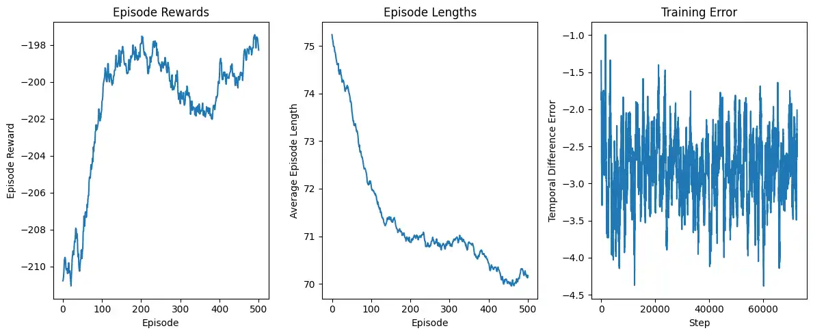
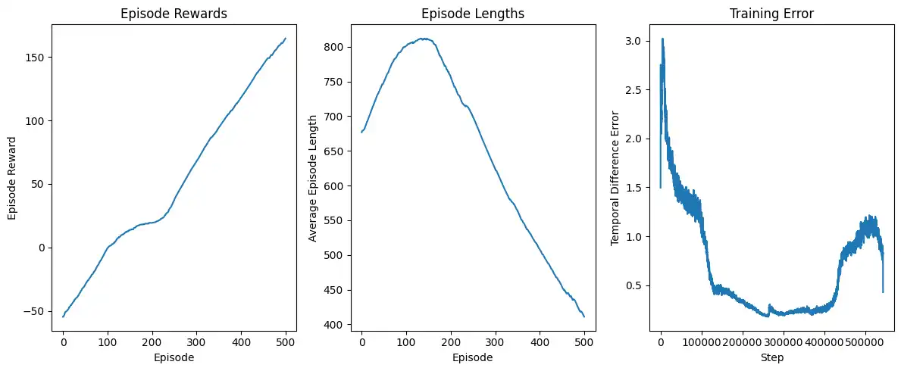
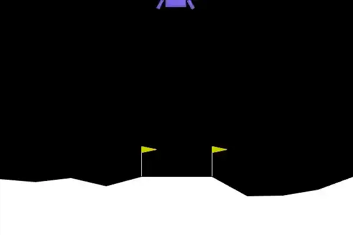
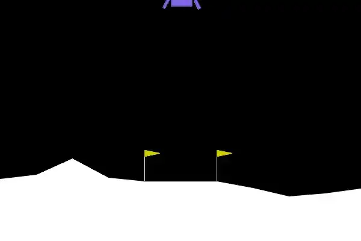
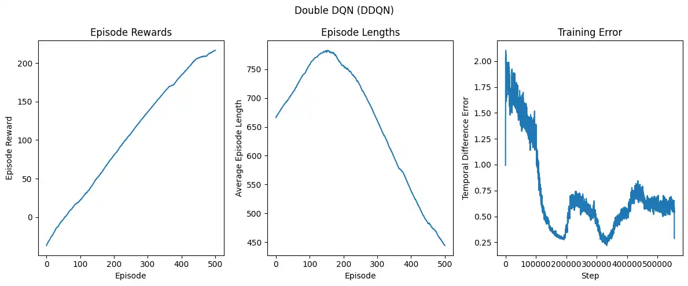
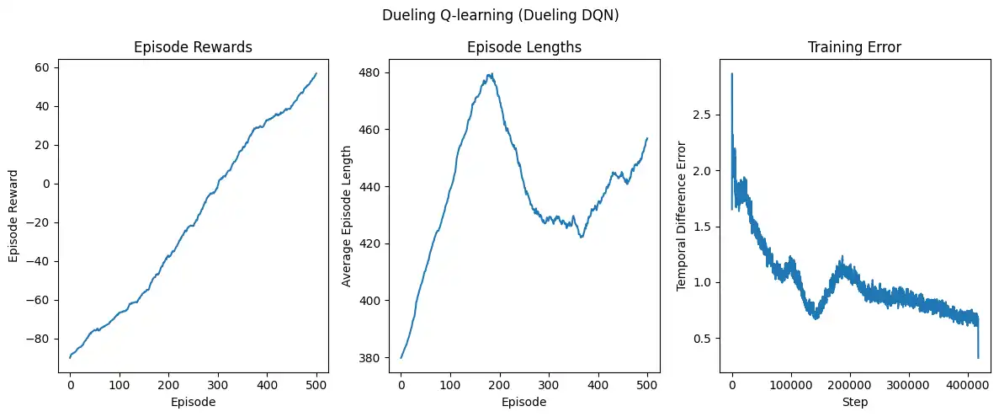
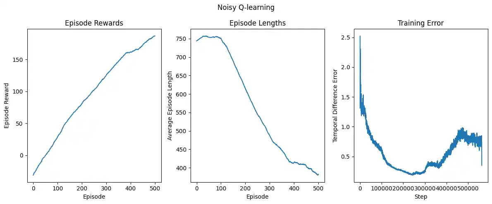
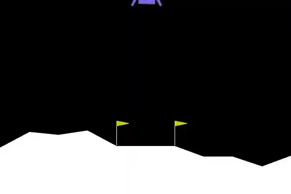
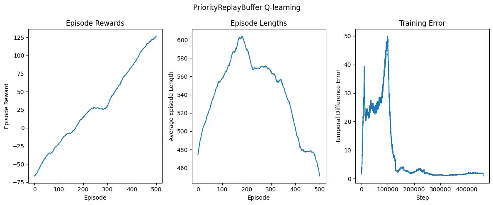
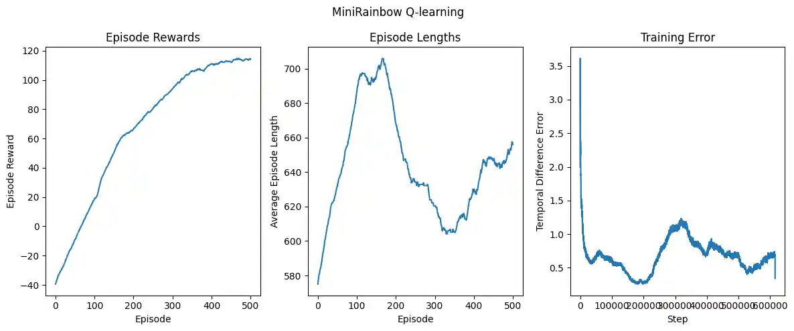

# Learning: Reinforced Learning - Q learning

{:.no_toc}

- 
{:toc}

## Introduction: Why I am writing this and what is reinforced learning.

I have interest in many topics. From electronics, embedded and 
[machine learning](https://en.wikipedia.org/wiki/Machine_learning).
When I was in University I took a course about Machine Learning. 
However, that was a kind of hard semester and the professor was somehow harsh,
we did not have too much time to learn and as many things I have written here
I ended up using AI to do projects. I was really pissed off because of that.
I consider I relatively understand well some fundamental math behind 
basic machine learning supervised algorithms, but I do not understand reinforced
learning and unsupervised methods as well. Since I do consider those projects 
utter shit and I did not learn too much about practical implementation (code) of 
reinforced learning algorithms I am trying to practice and rediscover a little bit some
knowledge.

Then, what is [reinforced learning](https://www.geeksforgeeks.org/machine-learning/what-is-reinforcement-learning/) (RL)?
It is a subset of Machine Learning (ML) algorithms that focuses on how an agent or decision maker
can learn to make "good" decision through trial and error to maximize an accumulative reward. 
The agent learns by interactions with the environment (the world or system in which the
agent operates) and receive some feedback based on actions and state (situation or condition
the agent is currently in). 

To put in practice RL algorithms is necessary then to define an environment.
It is not easy at all since it does require defining many things like the problem
itself, physics, states, actions and reward. How you define all of those parameters
heavily defines the complexity of problem. Also, to be able to 
use a set of algorithm is different environments it would be very good to have 
a set of functions or rules that allow us to define environments. 
Well, that exist and is called [Gymnasium](https://gymnasium.farama.org/introduction/basic_usage/).
It does not only allow us to create our custom environments, but also it has 
some common already defined problems. So I am going to put in practice some of them;
in fact I am going to try to solve some Atari games. 

## Understanding the most basic Agent-Environment loop with Q-Learning

The idea behind Q-Learning algorithm is to build some kind of giant "cheat sheet"
or lookup table that tells the agent how good is an action based in its current
state. The basic Q-learning uses a memory buffer with a matrix like approximation
where rows (i) represent states (situations) that agent may encounter, 
columns (j) different actions than the agent can take and the value (C)
in each cell $$C_{ij}$$ how good the action is in that situation (<i>expected</i> future reward),
this is called Q-value. This value is updated following a temporal difference (TD) rule,
according to the following formula.

$$ Q(S, A) \leftarrow Q(S, A) + \alpha (R + \gamma Q(S^{\prime}, A^{\prime} - Q(S, A)) $$

- S: The current state
- A: The action taken by the agent
- $$S^{\prime}$$: The next state the agent moves to.
- $$A^{\prime}$$: Is the best next action in state $$S^{\prime}$$
- R: The reward received for taking action A in state S. 
- $$\gamma$$: Called discount factor, it balances immediate rewards with future rewards. 
- $$\alpha$$: The learning rate, determine how much new information affects old Q-values.

The term multiplied by the learning rate ($$\alpha$$) is called Bellman's equation. 
It is a fundamental equation that determines the optimal action.
It is sometimes expressed in this other way:

$$ Q(S, A) = R(S, A) + \gamma max_{a}Q(S^{\prime}, A) $$

But, what action does that agent takes in each iteration? One options is to use 
the $$\epsilon$$-greedy policy. This helps the agent to decide which action to take
by selecting the best known actions with probability $$1-\epsilon$$ and a random
action with probability $$\epsilon$$. This ensures the agent exploits knowledge 
most of the time while occasionally to discover new options to avoid getting stuck in
non-optimal behaviors. A common approach is to give large probability 
of exploration at first a then reduce exploration with a factor called <i>epsilon-decay</i>.

### Selecting an environment: Lunar Lander

For example, for [Lunar Lander](https://gymnasium.farama.org/environments/box2d/lunar_lander/)
The observation space (situations) is a 8-dimensional vector that contains 
x, y position of lander, dx/dt and dy/dt or velocities in x and y, its angle $$\theta$$,
its angular velocity $$\omega$$, and two Boolean that represents each leg 
is in contact with ground, or it is not. On the other hands its 
actions spaces is an integer with four possible values: 0, do nothing, 1; Fire left orientation engine;
2, fire main engine; 3, Fire right engine. Finally, about the rewards, 
it is the sum of all steps in the episode:

- Is increased/decreased the closer/further the lander is to the landing pad.
- Is increased/decreased the slower/faster the lander is moving.
- Is decreased the more the lander is tilted (angle not horizontal).
- Is increased by 10 points for each leg that is in contact with the ground.
- Is decreased by 0.03 points each frame a side engine is firing.
- Is decreased by 0.3 points each frame the main engine is firing
- The episode receive an additional reward of -100 or +100 points for crashing or landing safely respectively.
- An episode is considered a solution if it scores at least 200 points.

For the moment is not really too much important to know this. But it is useful information in many cases.

The core of most of the algorithms is like this (changing maybe the hyperparameters):

{:.code-box}
~~~python
import gymnasium as gym #enviroment crafting library 
import ale_py #some atary games enviroments

# model hyperparameters
learning_rate = 0.05
n_episodes = 600
start_epsilon = 1.0
epsilon_decay = start_epsilon / (n_episodes / 4)
final_epsilon = 0.0001
discount_factor = 0.99

gym.register_envs(ale_py) # register as available the atary enviroments
#create an enviroment using LunarLander-v3. Some custom parameters my be added for extra complexity
env = gym.make("LunarLander-v3", continuous=False, gravity=-10.0, enable_wind=True,
wind_power=5.0, turbulence_power=0.5)
#wrap the enviroments with a tool that allow to register statistic per episode
env = gym.wrappers.RecordEpisodeStatistics(env, buffer_length=n_episodes)

#create our agents (this will change according to the designed agent or strategy). 
agent = LunarLanderAgent(env, learning_rate, start_epsilon, final_epsilon, epsilon_decay, discount_factor)

#training loop for n episodes
for episode in tqdm(range(n_episodes)):
    observation, info = env.reset() #its is important to reset the enviroment to a default know state always
    steps_done = 0

    done = False
    while not done:
      #select an action from q table according to current observation space (situation)
      action = agent.get_action(observation) 
      #eval the action and takes the reward, next state and reward information
      next_observation, reward, terminated, truncated, info = env.step(action)
        
      #update the q learning table of agent with the obtained reward and observation 
      agent.update(observation, action, reward, terminated, next_observation, steps_done)

      #update the q table with the state and reward resultant from taking action
      observation = next_observation
      steps_done += 1
        
      #if the reward is over 200 or it taked too much time then training episode end
      done = terminated or truncated

    #it reduce exploration over time a began to exploit more the learned stuff
    agent.decay_epsilon()
~~~

### Implementing Q-learning to solve the problem.

The interesting part is selection the adequate agent. Since this in the first 
one, here I will introduce q-learning, following the description of above. Here 
is the code and comments explaining what it does.

{:.code-box}
~~~python

from collections import defaultdict
import numpy as np
import gymnasium as gym

class LunarLanderAgent:
  def __init__(
      self,
      env: gym.Env,
      learning_rate: float,
      initial_epsilon: float,
      final_epsilon: float,
      epsilon_decay: float,
      discount_factor: float):

    self.env = env
    
    # initialize the q table with an array of zeros
    # and shape m x n; where m rows are observations and n columns are actions space
    # every new observation adds a entry in dictionary with a vector of size n
    # and default values of zero
    self.q_values = defaultdict(lambda: np.zeros(self.env.action_space.n))

    self.learning_rate = learning_rate
    self.epsilon = initial_epsilon
    self.final_epsilon = final_epsilon
    self.epsilon_decay = epsilon_decay
    self.discount_factor = discount_factor
    
    # keep track of training results 
    self.training_error = []

  def get_action(self, observation: np.ndarray):
    # uses epsilon greedy strategy.
    # it is necessary to turn the numpy array of the observation
    # to an unshable data type as tuple
    observation = tuple(observation)

    if np.random.random() < self.epsilon: # exploration
      return self.env.action_space.sample()
    else: # exploit learning
      return np.argmax(self.q_values[observation])

  def update(self,
             observation: np.ndarray,
             action: int,
             reward: float,
             terminated: float,
             next_observation: np.ndarray,
             steps: int = 0):
    # convertion to tuple required since ndarray are unhasable
    observation = tuple(observation)
    next_observation = tuple(next_observation)

    # if the episode has terminated then no future action takes place
    future_q_value = (not terminated) * np.max(self.q_values[next_observation])
    
    # bellmans quation
    target_reward = reward + self.discount_factor * future_q_value
    # temporal difference
    error = target_reward - self.q_values[observation][action]
    # update q table with temporal difference  or error shift
    self.q_values[observation][action] = (
        self.q_values[observation][action] + self.learning_rate * error
    )

    self.training_error.append(error)

  def decay_epsilon(self):
    # reduce exploration over time
    self.epsilon = max(self.final_epsilon, self.epsilon - self.epsilon_decay)
~~~

I also added some extra utility functions to reuse in some other strategies later. 
I will add them here.

{:.code-box}
~~~python
from tqdm import tqdm
import matplotlib.pyplot as plt
import torch

# I moved the exactly training loop from avobe to a function with this name
def training_agent(n_episodes, env: gym.Env, agent):
    pass

# This function calculates test the agent post training 
def test_agent(n_episodes: int, env: gym.Env, agent):
  total_reward = []
  old_epsilon = agent.epsilon #save its e-greedy policy
  agent.epsilon = 0.0 # totally exploit what it learned

  for episode in tqdm(range(n_episodes)):
    observation, info = env.reset()
    episode_reward = 0
    done = False

    while not done:
      action = agent.get_action(observation)
      observation, reward, terminated, truncated, info = env.step(action)
      episode_reward += reward
      done = terminated or truncated

    total_reward.append(episode_reward)
  agent.epsilon = old_epsilon

  win_rate = np.mean(np.array(total_reward) > 0)
  average_reward = np.mean(total_reward)
  standar_deviation = np.std(total_reward)

  print(f"Number of episodes: {n_episodes}")
  print(f"Win rate: {win_rate:.2%}")
  print(f"Average reward: {average_reward:.4f}")
  print(f"Standar deviation: {standar_deviation:.4f}")

def get_moving_avgs(arr, window, convolution_mode):
      """Compute moving average to smooth noisy data."""
      # Detach tensors and convert to numpy before flattening
      arr_np = np.array([item.detach().cpu().numpy() if isinstance(item, torch.Tensor) else item for item in arr])
      return np.convolve(
        arr_np.flatten(),
        np.ones(window),
        mode=convolution_mode,
      ) / window

def plot_training_graphs(env, agent):
  rolling_length = 500
  fix, axs = plt.subplots(ncols=3, figsize=(12,5))

  axs[0].set_title("Episode Rewards")
  reward_moving_average = get_moving_avgs(
    env.return_queue,
    window=rolling_length,
    convolution_mode="valid",
  )
  axs[0].plot(range(len(reward_moving_average)), reward_moving_average)
  axs[0].set_ylabel("Episode Reward")
  axs[0].set_xlabel("Episode")

  axs[1].set_title("Episode Lengths")
  length_moving_average = get_moving_avgs(
    env.length_queue,
    window=rolling_length,
    convolution_mode="valid",
  )
  axs[1].plot(range(len(length_moving_average)), length_moving_average)
  axs[1].set_ylabel("Average Episode Length")
  axs[1].set_xlabel("Episode")

  axs[2].set_title("Training Error")
  error_moving_average = get_moving_avgs(
    agent.training_error,
    window=rolling_length,
    convolution_mode="same",
  )
  axs[2].plot(range(len(error_moving_average)), error_moving_average)
  axs[2].set_ylabel("Temporal Difference Error")
  axs[2].set_xlabel("Step")

  plt.tight_layout()
  plt.show()

def eval_model(env, agent, folder, name_prefix):
  # records agent behavior in a video
  eval_env = gym.wrappers.RecordVideo(
      env,
      video_folder=folder,  # where to save video
      name_prefix=name_prefix, # prefix name of videos
      episode_trigger= lambda ep: True # save video every episode
  )
  old_epsilon = agent.epsilon # save its current e-greedy policy
  agent.epsilon = 0 # totally explot what it learned

  num_videos_episode = 5 # numver of videos in a episode (only a episode)
  for _ in range(num_videos_episode):
    observation, info = eval_env.reset()
    done = False
    while not done:
      action = agent.get_action(observation)
      observation, reward, terminated, truncated, info = eval_env.step(action)
      done = terminated or truncated

  agent.epsilon = old_epsilon
  eval_env.close() # closes the enviroment

~~~

Then the loop of training, testing and evaluation can be replaced with this:

{:.code-box}
~~~python
agent = LunarLanderAgent(env, learning_rate, start_epsilon, final_epsilon, epsilon_decay, discount_factor)

print("Training agent")
training_agent(n_episodes, env, agent)

print("Training graphs")
plot_training_graphs(env, agent)

print("Testing agent")
test_agent(100, env, agent)

print("Evaluating agent")
# render_mode "rgb_array" is required to generate videos
env = gym.make("LunarLander-v3", continuous=False, gravity=-10.0, enable_wind=True, 
wind_power=5.0, turbulence_power=0.5, render_mode="rgb_array") 
eval_model(env, agent, "videos-q", "lunar_lander")
~~~

In the image above we have the result of training and...wait it did not learn. 
Thought the episode reward curve seems to increase in the range to 1000 episodes,
the maximum reward is negative -198, and the curve of moving training error is practically random/noisy.
The tested win rate barely approaches to 1.0%.
When I was learning about Q-learning I tried using Blackjack environment, and it worked fine,
it even reached about 45% of win rate, which is huge in that game; then why I does
not work here. Well, Q-learning have an issue, it adds new entries
per state (rows), so if there are many states the Q-learning will becomes huge
with very low reward per action. In consequence, it is very likely 
that the agent will act almost random in each iteration. 
How may it be solved? Instead of using a fixed "cheet-table"
it could be better to find relations in similar states and learn from
them to fill a Q-table with approximation. But then it requires to learns,
so it introduces a neural network as estimator of Q-values.

## Improving Q-learning with ANN: Deep Q-learning (DQN) - reducing lookup table size:

Atari's environments may have a large observation space: images of shape (210, 160, 3)
(three channel because of RGB) and pixel range from 0 to 255. In consequence
$$256^{210\times 160\times 3}=256^{100800}$$ possible observations. Therefore,
the Q-table for this should be insane huge. The idea is then approximate Q-values
using parametrized Q-function $$Q_{\theta}(s, a)$$ and its done with a neural network.

In deep Q-learning a defined loss function compares the Q-value from prediction with a 
Q-target and uses the difference between this values to perform gradient descent to update 
weights of the Deep-Q network to approximate Q-values better. 

The algorithm has two phases. An action is executed as always, as presented in the previous section. 
The observed experience is stored in a memory buffer called <b>replay memory</b>. 
Then, a small batch of experiences is selected from the replay memory and uses this batch 
to calculate gradient descent improving the neural network. 

Also, the training process is actually implemented with two neural networks. 
A policy network $$Q(s, a)$$ and a target network $$\hat{Q}(s, a)$$. 
This was to me a hard thing to understand. Why you need an extra neural network that "learns 
the same" as the policy network. With Q learning each step only one pair state-action
is updated, whereas with DQN many pair state-action are being updated each step
when the policy neural network updates. The problem this causes is that it can affect 
the q-values for every next step state the agent will be in, instead of guarantying  
them to be stable. The effect this causes is called "catastrophic forgetting",
it shows as reward curve over steps going up, then all of a sudden it completely goes
down to a very low reward. Using a stable network, target network, may help to reduce this effect.
It has some "basic understanding" about how to increase reward and keeps trying 
it out until the policy network find a better solution. 

This is my implementation (a very bad one)

{:.code-box}
~~~python
import torch.nn as nn
import torch.optim as optim
import torch
from collections import deque
import random

class QNetwork(nn.Module):
  def __init__(self, input_size, output_size):
    super(QNetwork, self).__init__()
    # nn.Linear Applies an affine linear transformation to the incoming data: 
    # y=xA^T+b
    # input_size = lenght of observation vector
    # output_size = number of posible actions
    self.fc1 = nn.Linear(input_size, 128) # output shape [128], reduces feature in fully connected
    self.fc2 = nn.Linear(128, 128)  #output shape [128], add extra non linearty
    self.fc3 = nn.Linear(128, output_size)  # output shape [output_size] # reduce feature in fully connected

  def forward(self, x):
    #applies non linearty with relu activation function
    x = torch.relu(self.fc1(x)) 
    x = torch.relu(self.fc2(x))
    # output just reduces fatures to possible classes/actions
    return self.fc3(x)

class LunarLanderAgentDQN:
  def __init__(
      self,
      env: gym.Env,
      learning_rate: float,
      gamma: float,
      initial_epsilon: float,
      final_epsilon: float,
      epsilon_decay: float,
      discount_factor: float,
      memory_size: int = 1000,
      batch_size: int = 64,
      target_net_update_frequency: int = 100
      ):
    self.env = env
    
    input_dim = self.env.observation_space.shape[0] # lenght of observation vector
    output_dim = self.env.action_space.n # number of posible actions

    self.policy_net = QNetwork(input_dim, output_dim)
    self.target_net = QNetwork(input_dim, output_dim)
    self.target_net.load_state_dict(self.policy_net.state_dict())

    self.learning_rate = learning_rate
    self.gamma = gamma
    self.epsilon = initial_epsilon
    self.final_epsilon = final_epsilon
    self.epsilon_decay = epsilon_decay
    self.discount_factor = discount_factor
    self.batch_size = batch_size
    self.target_net_update_frequency = target_net_update_frequency
    
    #first in first out memory that grows to a maximum fixed size
    #memory buffer
    self.memory = deque(maxlen=memory_size) 

    self.optimizer = optim.Adam(self.policy_net.parameters(), lr=learning_rate)
    self.criterion = nn.SmoothL1Loss()

    self.training_error = []

  def get_action(self, observation):
    # e-greedy policy to select action
    if np.random.random() < self.epsilon:
      return self.env.action_space.sample()
    else:
      # transform the observation a tensor
      obs = torch.FloatTensor(observation).unsqueeze(0)
      q_values = self.policy_net(obs)
      return torch.argmax(q_values).item() # item "unwrap" the maximum value from a tensor

  def update(
      self,
      observation,
      action,
      reward,
      terminated,
      next_observation,
      steps_done):

    # store a new observation in the memory buffer in a queue
    self.memory.append((observation, action, reward, terminated, next_observation))
    
    # if memory has not sufficient observation then skip and continue
    # performing randon actions
    if len(self.memory) < self.batch_size:
      return
    
    # takes a batch of actions stored in the memory buffer
    # transfrom the batches into tensors
    # it is necessary to turn them into np.array first becuase direct transformation is very slow
    batch = random.sample(self.memory, self.batch_size)
    state_batch, action_batch, reward_batch, terminated_batch, next_state_batch = zip(*batch)

    state_batch = torch.FloatTensor(np.array(state_batch))
    action_batch = torch.LongTensor(np.array(action_batch)).unsqueeze(1)
    reward_batch = torch.FloatTensor(np.array(reward_batch))
    terminated_batch = torch.FloatTensor(np.array(terminated_batch))
    next_state_batch = torch.FloatTensor(np.array(next_state_batch))

    # Compute Q-values for current states
    q_values = self.policy_net(state_batch).gather(1, action_batch).squeeze()

    # Compute target Q-values using the target network
    with torch.no_grad():
        # Bellmans equation
        max_next_q_values = self.target_net(next_state_batch).detach().max(1)[0]
        target_q_values = reward_batch + self.gamma * max_next_q_values * (1 - terminated_batch)
    
    # compute loss and optimize model
    loss = nn.SmoothL1Loss()(q_values, target_q_values) # updates q values of policy net
    #loss = self.criterion(q_values, target_q_values)
    self.training_error.append(loss.item())

    self.optimizer.zero_grad()
    loss.backward()
    # clips the L2 norm of all gradients in the policy network to a maximum of 10
    # this modifies the gradients in place after back progration and before optimizer step
    # If norm excedes 10 it is scaled down preventing exploding gradients during training
    torch.nn.utils.clip_grad_norm_(self.policy_net.parameters(), max_norm=10)
    self.optimizer.step()
    
    # every C steps update the target net
    if steps_done % self.target_net_update_frequency == 0:
      self.target_net.load_state_dict(self.policy_net.state_dict()) # update q values of target net

  def decay_epsilon(self):
    self.epsilon = max(self.final_epsilon, self.epsilon - self.epsilon_decay)

  def save_mode(self):
    # when saving we save the policy net we are intereted in
    torch.save(self.policy_net.state_dict(), "dqn_lunarlander.pth")
~~~

Then what we get? As shown in the image above the training curve of this model 
is always in increment. Is surpass 150 of moving reward.
Also, as more is the model trained the average length of episode decreases as well as the training error. 
In the test exploiting what the model learned it reached 100% of win rate as well as an
average reward over 237 with a standard deviation of 35. Maybe the bad thing is 
that the training error curve seems to decrease and then at certain point after many steps
the curve starts to increase. The question is could the training error continue increasing
as more steps are taken?

To complement what it has been done to the moment look at the videos below. The video at the left 
is result of the previous Q learning algorithm meanwhile the video at the right 
is an example of an episode with the DQN. As you can see while the Q-learning the lunar lander
just crashes while throwing almost random actions, on the other hand the DQN lands smoothly. 
Furthermore, almost at the end, in DQN the lander was landing slightly out of zone and then 
the agent fires for a moment the main engine to properly put 
the lander in the correct place. A very good solution.

## Deep Q learning variants and improvements: Double DQN an improvement over Q-value overestimation.

As I was written this I found a post in StackOverflow saying that Q learning was considered 
obsolete, but its principles continue being used in better solutions. 
Also, I tried, before writing this post to solve another environment and some problems 
came in that made my solution very bad. So of course many of implementations here would require
some improvement, and its also part about why I decided to write this in first place. 
I found in medium also another post taking about
<a href="https://medium.com/data-science/rainbow-the-colorful-evolution-of-deep-q-networks-37e662ab99b2">Rainbow DQN</a>;
but guest what… It is essentially a collection of many other improvements to the basic Q-learning placed together. 
And at first read it became really hard to understand. Then lest try to explore
them one by one. The first improvement is called Double DQN and its main goal is to avoid bias overestimation.

Remember how is the temporal difference TD calculated. It has a interesting philosophical problem.
How could we be sure that the best action for the next state is the action with the highest Q-Value?.
There is no enough information in the beginning of training about what is the best action to take. 
Therefore, taking a maximum Q-value which is noise could potentially lead to false positives. 
If the process continues, and non-optimal actions are regularly given a higher Q-value,
the learning may diverge or increase error. One proposed solution is to decouple 
in the neural network, the action selection and the Q-value generation… That sounds complicated. 
The process is as follows:

<ul>
  <li>Action selection: Use the current online network \(Q_{\theta}\) (the one being actively trained or policy network)
to determine the action \(a^{*}\) that it estimates to be the best in the next state \(s_{t+1}\).</li>
</ul>

$$a^{*}=\underset{a}{arg\,max}Q_{\theta}(s_{t+1}, a^{\prime})$$

<ul>
  <li>Action evaluation: Uses the target network \(\hat{Q}_{theta}\) (the periodically updated or target network)
to evaluate the Q-value of the action \(a^{*}\) selected in previous step.</li>
</ul>

$$\hat{Q}_{theta}(s_{t+1}, a^{*})$$

<ul>
  <li>Target value: Combines this two to form the new target value \(y_{t}^{DDQN}\)</li>
</ul>

$$y_{t}^{DDQN}=r_{t}+\gamma \hat{Q}_{theta}(s_{t+1}, \underset{a}{arg\,max}Q_{\theta}(s_{t+1}, a^{\prime}))$$

<pre class="highlight"><code># only this three lines changes
# Compute target Q-values using the double dqn (ddqn)
with torch.no_grad():
  next_actions = self.policy_net(next_state_batch).argmax(dim=1, keepdim=True)
  max_next_q_values = self.target_net(next_state_batch).gather(1, next_actions).squeeze()
  target_q_values = reward_batch + self.gamma * max_next_q_values * (1 - terminated_batch)
</code></pre>

This solution has a very similar result. Just the reward per episode curve
is slightly more stable as well as the training error or temporal difference curve.
This also has a 100% win rate and average reward of 237.

## Dueling DQN an improvement over bias over-estimation.

DQN estimates the Q-value learning a function that directly maps state-action pairs to a expected reward.
It is said that this approach is inefficient in environments where the value of the state itself 
vastly influences the expected reward, regardless of the action taken. Dueling DQN tries to solve
this by decomposing the neural network itself in two paths.

<ul>
  <li>
    
The value stream V(s): This stream estimates the probability of being in a particular
state independently of the action taken.

  </li>
  <li>
    
The advantage stream A(s,a): This calculate the additional value of taking an specific action from that state, 
relative to the other actions.

  </li>
</ul>

Combining the value stream and advantage stream it is obtained the Q-values. 
The aggregation is done in such a way that it maintains a relative advantage of each action 
while ensuring that the Q-values are grounded in the actual value of being in that state
Training the neural network by simple addition is not possible. In Q=V+A
given the function Q there are infinite solutions. The algorithm forces then 
the highest Q-value to be equal to the value V making the highest value in the advantage zero
and all other values negative. However, the paper also suggest replace the maximum 
for the mean.

$$Q(s, a) = V(s) + (A(s, a) - \underset{a^{\prime}\in |A|}{max}A(s, a^{\prime})$$

$$Q(s, a) = V(s) + \left(A(s, a) - \frac{1}{|A|}\sum_{a^{\prime}\in |A|}A(s, a^{\prime}) \right)$$

Here an example of dueling Q Network. Notice how the only change in the code from basic Q-learning
is the neural network.

<pre class="highlight"><code>class DuelingQNetwork(nn.Module):
  def __init__(self, input_dim, output_dim, adv_type="avg") -&gt; None:
    super(DoubleQNetwork, self).__init__()
    self.fc1 = nn.Linear(input_dim, 128)
    self.fc2 = nn.Linear(128, 64)
    self.fc_adv = nn.Linear(64, 256)
    self.fc_value = nn.Linear(64, 256)
    self.adv = nn.Linear(256, output_dim)
    self.value = nn.Linear(256, 1)

    self.adv_type = adv_type

  def forward(self, observation):
    x = F.relu(self.fc1(observation))
    x = F.relu(self.fc2(x))

    x_adv = F.relu(self.fc_adv(x))
    x_adv = F.relu(self.adv(x_adv))

    x_value = F.relu(self.fc_value(x))
    x_value = F.relu(self.value(x_value))

    if self.adv_type == "avg":
      advAverage = torch.mean(x_adv, dim=1, keepdim=True)
      q_value = x_value + x_adv - advAverage
    else:
      advMax, _ = torch.max(x_adv, dim=1, keepdim=True)
      q_value = x_value + x_adv - advMax

    return q_value
</code></pre>

Notice in this case how the initial rewards in the reward per episode curve starts as negative
in opposition to the other cases and also the learning seems to be slower since the episode length 
decreases slower, even in some section after some steps the episode length started increasing. 
The win rate is also much slower; just 78% with an average reward of 113.48 and standard deviation
125.68.

I consider important to express here that the objective of this post is mainly to learn about the algorithms
and why they do exist. To properly study each algorithm it is convenient to run hyperparameter optimization
and test many cases to avoid biased result because of randomness. These algorithms have a high stochastic 
component that affects result from run to run. 
I am not doing all that, I am just running once with same hyperparameters for all algorithms.

## Noisy networks: Improvement over exploration policy.
This improvement addresses a problem related with how exploration is done.
In classic DQN exploration vs exploit is done by some policy that tell the agent
what action to take. The implementation I have done uses epsilon greedy policy;
and it is defined by a hyperparameter epsilon which is decreased over time 
so that the agent starts taking actions quite random, and then it uses what it learned.
It is said that this process work well with environments with short episodes. 
This parameter usually should be optimized according to the problem.

The solution that noisy networks propose is to add noise at the last linear layer
of the neural network and adjust the parameter of noise during training with backpropagation.
There are two approaches to add noise:

- Independent Gaussian noise: For every weight in a fully connected layer, 
there is a random value drawn from a normal distribution. Parameters of Gaussian noise 
$$\mu$$ and $$\sigma$$ are stored inside the layer and trained as well as with a standard linear layer.

$$ y = (b + Wx)+(b_{noisy}\cdot \epsilon^{b}+(W_{noisy}\cdot \epsilon^{w})x)  $$

- Factorized Gaussian Noise: To minimize the number of random values to be sampled it is used only two random vectors:
The first one with equal number of features as input and the second one with same size as the output
of the layer. Then, a random matrix for the layer is created by calculating the outer product of the vectors.

The next code is implementation of Independent Gaussian Noise.
I borrowed this code from Maxim Lapan Deep Reinforcement Learning Hands-On.

~~~python
class NoisyLinear(nn.Linear):
    def __init__(self, in_features, out_features,
    sigma_init=0.017, bias=True):
    super(NoisyLinear, self).__init__(
    in_features, out_features, bias=bias)
    w = torch.full((out_features, in_features), sigma_init)
    self.sigma_weight = nn.Parameter(w)
    z = torch.zeros(out_features, in_features)
    self.register_buffer("epsilon_weight", z)
    if bias:
        w = torch.full((out_features,), sigma_init)
        self.sigma_bias = nn.Parameter(w)
        z = torch.zeros(out_features)
        self.register_buffer("epsilon_bias", z)
    self.reset_parameters()

    def reset_parameters(self):
        std = math.sqrt(3 / self.in_features)
        self.weight.data.uniform_(-std, std)
        self.bias.data.uniform_(-std, std)
    
    def forward(self, input):
        self.epsilon_weight.normal_()
        bias = self.bias
        if bias is not None:
            self.epsilon_bias.normal_()
            bias = bias + self.sigma_bias * self.epsilon_bias.data
        v = self.sigma_weight * self.epsilon_weight.data + self.weight
        return F.linear(input, v, bias)

# then in basic DQN network just one line changes
    class NoisyNetwork(nn.Module):
      def __init__(self, input_size, output_size):
        super(NoisyNetwork, self).__init__()
        self.fc1 = nn.Linear(input_size, 128)
        self.fc2 = nn.Linear(128, 128)
        self.fc3 = NoisyLinear(128, output_size)

# and get rid of epsilon greedy policy
    def get_action(self, observation):
        q_values = self.policy_net(torch.FloatTensor(observation).unsqueeze(0))
        return torch.argmax(q_values).item()
~~~

This learns as well as the previous Q improvements. The average reward, episode length curves are very stable. 
The learning error decreases up to 300 thousand steps. Then it increases for a moment and keeps there;
around 1.0% of temporal difference. The final model has 87% win rate and average reward 173.15 with standard
deviation 102. I think it is important to add another clarification here about the models and 
the scope of this first model exploration. I am not using the best model per run. 
Not only that, but I am using the last model.
I think that is important because in most models in last steps temporal difference tends to increase again.
In consequence decreasing performance. It is still clear that it is learning. I will try to explore this
models deeper later in this same little article.

## Prioritized Replay Buffer: Training more on surprising data.
 This method tries to improve the efficiency of samples in the replay buffer by prioritizing those
samples according to the training loss.
The basic DQN uses a replay buffer to break correlation between transitions; 
since each experience is highly correlated if the environment is "smooth". 
However, the stochastic gradient descent (SGD) method assumes 
that the training data has an independent and identically distributed random variables (iid) property. 
To solve the problem classic DQN uses a large buffer and randomly select minibatches 
to get the next training batch.

The prioritized replay buffer improvement suggests a change in that policy, and instead
assign priorities to the samples in the replay buffer. Then sampling 
is done according to the priorities by showing high priority more. 
But how is priority measured? It is done by "surprise";
similar to Shannon's [Information Theory](https://en.wikipedia.org/wiki/Information_theory). 
The idea is to keep a balance between "unusual data" and training the rest of buffer, avoiding
overfitting. Every sample is calculated as $$P(i)=\frac{p_{i}^{\alpha}}{\sum_{k}p_{k}^{\alpha}}$$
where $$p_{i}$$ is the priority of i-th sample. $$\alpha$$ is a number that tells the importance 
given to a priority. It is a hyperparameter, but some works suggest starting with 0.6.

To define priority a proposed method is to make it proportional to the loss 
in each step during Bellman update. Every new sample added to the buffer 
has a maximum priority at born time, so that they will be sampled soon.

Adjusting priorities adds some bias to the data. 
Also, a suggestion done by Lapan and the original authors of this algorithm is
to use sample weights. The values are defined as $$w_{i}=(N\cdot P(i))^{-\beta}$$,
where $$\beta$$ is another hyperparameter between 0 and 1. 
The idea is start smaller than 1 and increase slowly to 1 during training.

Here is an adapted code taking from the reference book. 
I just changed some small parts to make it compatible with the rest of my code.
Most of the changes are in the replay buffer mechanism. 
In the agent there are some minimal changes in update method.

~~~python

PRIO_REPLAY_ALPHA = 0.6
BETA_START = 0.4
BETA_FRAMES = 100000

class PrioReplayBuffer:
    def __init__(self, buf_size, prob_alpha=0.6):
        self.prob_alpha = prob_alpha
        self.capacity = buf_size
        self.pos = 0
        self.buffer = deque(maxlen=buf_size)
        self.priorities = np.zeros((buf_size, ), dtype=np.float32)

    def __len__(self):
        return len(self.buffer)

    def populate(self, observation, action, reward, terminated, next_observation):
        max_prio = self.priorities.max() if self.buffer else 1.0
        if (len(self.buffer) == self.capacity):
          self.buffer[self.pos] = (observation, action, reward, terminated, next_observation)
        else:
          self.buffer.append((observation, action, reward, terminated, next_observation))

        self.priorities[self.pos] = max_prio
        self.pos = (self.pos + 1) % self.capacity

    def sample(self, batch_size, beta=0.4):
        if len(self.buffer) == self.capacity:
            prios = self.priorities
        else:
            prios = self.priorities[:self.pos]
        probs = prios ** self.prob_alpha

        probs /= probs.sum()
        indices = np.random.choice(len(self.buffer), batch_size, p=probs)
        samples = [self.buffer[idx] for idx in indices]
        total = len(self.buffer)
        weights = (total * probs[indices]) ** (-beta)
        weights /= weights.max()
        return samples, indices, np.array(weights, dtype=np.float32)

    def update_priorities(self, batch_indices, batch_priorities):
        for idx, prio in zip(batch_indices, batch_priorities):
            self.priorities[idx] = prio

    def update_beta(self, frame_idx):
        return min(1.0, BETA_START + frame_idx * (1.0 - BETA_START) / BETA_FRAMES)

### In the agent
    def update(self, observation, action, reward,
        terminated, next_observation, steps_done):

        self.memory.populate(observation, action, reward, terminated, next_observation)

        if len(self.memory) < self.batch_size:
          return

        beta = self.memory.update_beta(steps_done)
        samples, indices, weights = self.memory.sample(self.batch_size, beta)

        state_batch, action_batch, reward_batch, terminated_batch, next_state_batch = zip(*samples)

        state_batch = torch.FloatTensor(np.array(state_batch))
        action_batch = torch.LongTensor(np.array(action_batch)).unsqueeze(1)
        reward_batch = torch.FloatTensor(np.array(reward_batch))
        terminated_batch = torch.FloatTensor(np.array(terminated_batch))
        next_state_batch = torch.FloatTensor(np.array(next_state_batch))
        weights = torch.FloatTensor(weights)

        # Compute Q-values for current states
        q_values = self.policy_net(state_batch).gather(1, action_batch).squeeze()
        with torch.no_grad():
          max_next_q_values = self.target_net(next_state_batch).detach().max(1)[0]
          target_q_values = reward_batch + self.gamma * max_next_q_values * (1 - terminated_batch)

        criterion = nn.SmoothL1Loss(reduction='none')
        unreduced_loss = criterion(q_values, target_q_values)
        weighted_loss = unreduced_loss * weights
        loss = weighted_loss.mean()
        #losses = weights * (q_values - target_q_values) ** 2

        self.training_error.append(loss.item())

        self.optimizer.zero_grad()
        loss.backward()
        torch.nn.utils.clip_grad_norm_(self.policy_net.parameters(), max_norm=10)
        self.optimizer.step()

        priorities = unreduced_loss.detach().cpu().numpy() + 1e-5
        self.memory.update_priorities(indices, priorities)

        if steps_done % self.target_net_update_frequency == 0:
          self.target_net.load_state_dict(self.policy_net.state_dict())
~~~

Again, while the agent is indeed learning its final win rate is just 84%. 
In theory most of Q-learning improvements should get slightly higher win rate, 
but since I am not tuning hyperparameters and some initial rewards are lower than
final average reward is also lower. Also, in the case of replay buffer,
since the implementation of the buffer is slow this also takes longer time to train.

## Distributional DQN: Q-values as probability distribution in stochastic environments.

In the Markov decision process (MDP)
scenario, when the sequence of decisions needs to be made and every decision might
influence the future situation. 

This question a fundamental core of Q-learning; the Q value itself. 
In previous cases each step q values is calculated as consequence of 
pair action-state, and they are represented with a single number. 
But this raises an interesting conceptual issue. Is it possible
to squeeze all future possible rewards into a single number?
In more dynamic and complicated environments, the future could be stochastic, 
given then q values with different probabilities; in consequence 
each pair action-state is better described as a probability distribution function (PDF) 
rather than a single number.

Why do we limit ourselves by trying to predict an average
value for an action, when the underlying value may have a complicated underlying
distribution? That is what the inventors of this solution proposed. 
The overall idea is to predict the distribution of
value for every action. Also, the authors showed that the Bellman equation can be generalized for
a distribution as $$Z(x,a)\overset{D}{=}R(x,a)+\gamma Z(x^{\prime}, a^{\prime})$$;
where Z and R are PDF. 

Additionally, the loss must change for something suitable for distributions.
Author suggest Kullback-Leiber divergence (or cross-entropy).

### This improvement has been quite difficult to implement. I have not been able to make it work yet. 

## Rainbow DQN: A mix of improvements. 

Rainbow is the last improvement over Q-learning. 
And it is essentially just the combinations of all improvements mentioned above. 
You can also avoid mixing some of them if performance was worse than baseline.
Rainbow is going to be much slower to train. 
I ran one adding double DQN, dueling DQN, noisy DQN and priority replay buffer. 

# References 

[Basic Usage-What is reinforced learning](https://gymnasium.farama.org/index.html)

[Introducing Q-Learning](https://huggingface.co/learn/deep-rl-course/en/unit2/q-learning)

[Deep Q-Learning with Atari Games](https://huggingface.co/learn/deep-rl-course/en/unit3/from-q-to-dqn)

[Why is a target network required](https://stackoverflow.com/questions/54237327/why-is-a-target-network-required)

[Rainbow: The colorful evolution of Deep Q-Networks](https://medium.com/data-science/rainbow-the-colorful-evolution-of-deep-q-networks-37e662ab99b2) 

<a href="https://medium.com/@sainijagjit/understanding-dueling-dqn-a-deep-dive-into-reinforcement-learning-575f6fe4328c">Understanding Dueling DQN: A Deep Dive into Reinforcement Learning</a>

Maxim Lapan. (2020). Deep Reinforcement Learning Hands-On. Editorial PackT. Second Edition.
